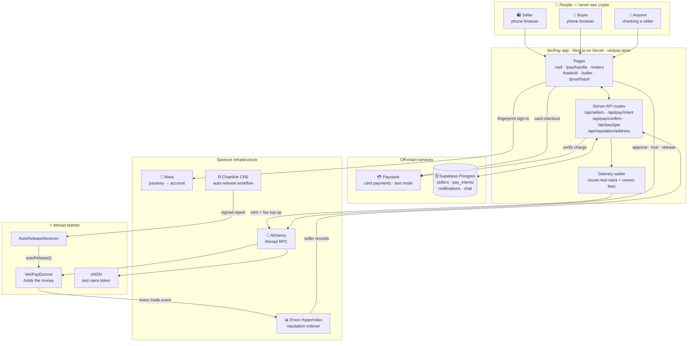
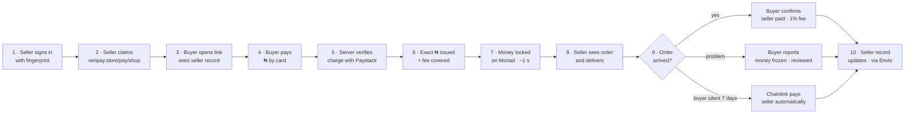
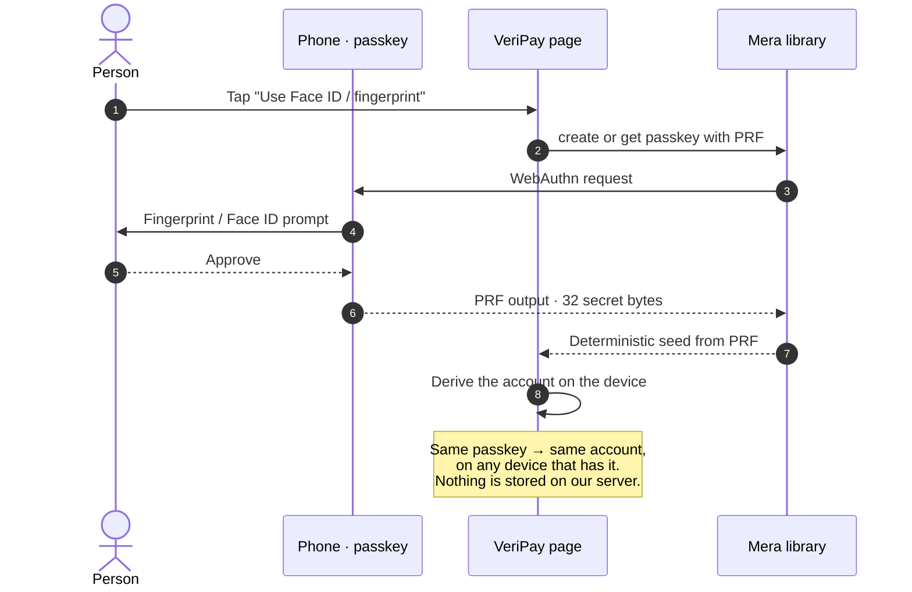
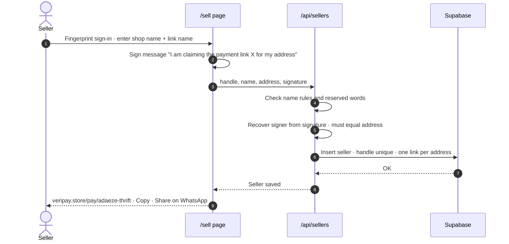
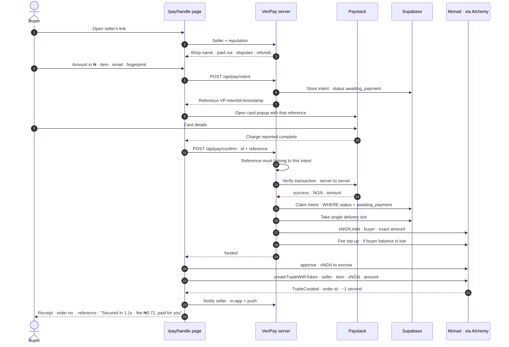
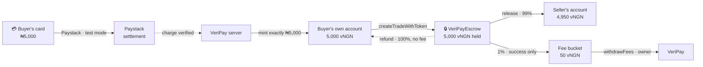
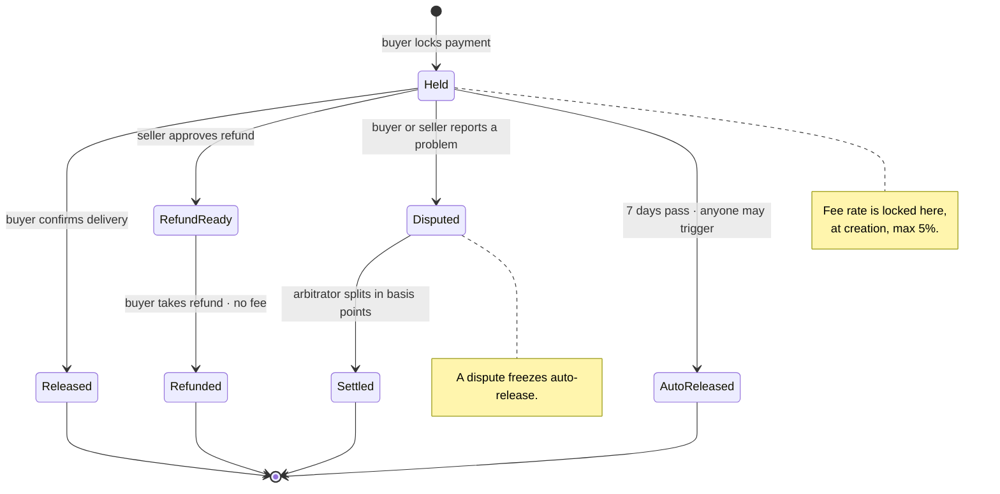
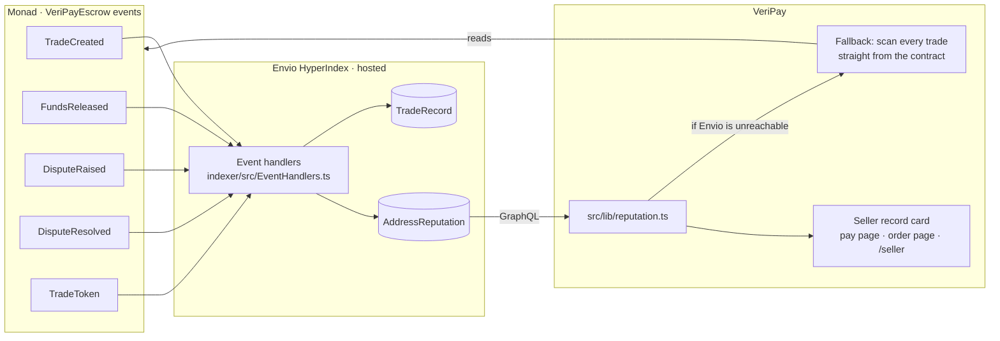
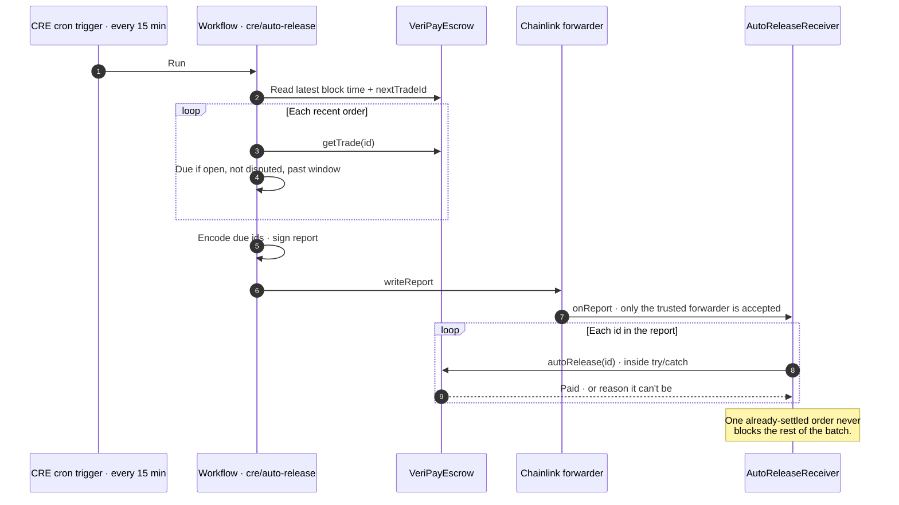
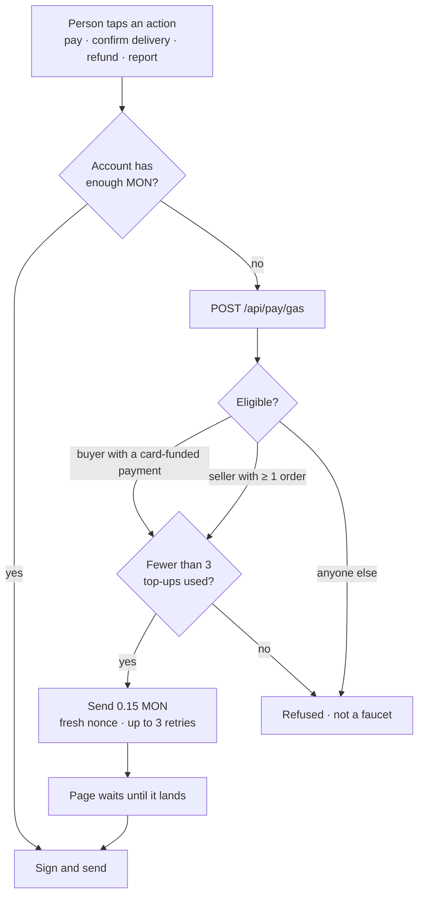

<div align="center">


# VeriPay

### Buy from anyone online. Pay only when it arrives.

**Buyer protection for social commerce, built on Monad.**
A seller shares one link. The buyer sees the seller's real track record, pays in naira with a fingerprint,
and the money is held until the order arrives. Nobody ever sees a wallet, a token or a gas fee.

[](https://veripay.store)
[](https://testnet.monadscan.com/address/0x00bdf9fbc9f59cc6814bbc7a91b19bbad1517e6d)
[](#)
[](https://veri-pay.mintlify.app)
[](./LICENSE)

</div>

---

## Watch it

<table>
<tr>
<td align="center" width="50%">
<a href="https://youtu.be/dxhIg5WTRA0"></a>
<br/><b><a href="https://youtu.be/dxhIg5WTRA0">▶ Demo video (2:17)</a></b>
<br/><sub>The full flow running on Monad testnet: seller link, card payment, lock, delivery, payout.</sub>
</td>
<td align="center" width="50%">
<a href="https://youtu.be/XqcZS5daLv8"></a>
<br/><b><a href="https://youtu.be/XqcZS5daLv8">▶ Pitch video (1:45)</a></b>
<br/><sub>The team, the problem, and why we're building it.</sub>
</td>
</tr>
</table>

<sub>The demo is an automated run of the real app against the live testnet contracts, with subtitles and an AI voice-over. <a href="./scripts/demo-video/README.md">How it was made.</a></sub>

| | |
|---|---|
| **Try it** | <https://veripay.store> — test card `4084 0840 8408 4081`, any future expiry, CVV `408` |
| **Check a seller** | Type `adaeze-thrift` at [veripay.store/seller](https://veripay.store/seller) (our demo shop) |
| **Hackathon** | Monad Metropolis · Track 02 · Consumer Products & Payments |
| **Network** | Monad testnet (chain id 10143) · test money only, nothing real moves |
| **Submission write-up** | [`HACKATHON.md`](./HACKATHON.md) |
| **Full documentation** | <https://veri-pay.mintlify.app> — also at [veripay.store/docs](https://veripay.store/docs) |

---

## Documentation

The complete documentation is at **[veri-pay.mintlify.app](https://veri-pay.mintlify.app)** (or [veripay.store/docs](https://veripay.store/docs), which forwards there). Every technical explanation has an "In plain words" dropdown, so it works for a first-time shopper as well as an auditor.

| If you are… | Start here |
|---|---|
| Trying VeriPay for the first time | [Quickstart](https://veri-pay.mintlify.app/quickstart) — the full flow on testnet in 5 minutes |
| Buying | [Buyer guide](https://veri-pay.mintlify.app/guides/buyers/overview) |
| Selling | [Seller guide](https://veri-pay.mintlify.app/guides/sellers/overview) |
| Curious how it's built | [Architecture](https://veri-pay.mintlify.app/architecture/overview) |
| Reviewing the contracts | [VeriPayEscrow reference](https://veri-pay.mintlify.app/contracts/escrow/overview) · [Invariants](https://veri-pay.mintlify.app/security/invariants) |
| Integrating | [API reference](https://veri-pay.mintlify.app/api/overview) · [Integration guide](https://veri-pay.mintlify.app/developers/integration-guide) |
| Checking what's not done yet | [Known limitations](https://veri-pay.mintlify.app/security/known-limitations) |

The source is in [`docs/`](./docs) and publishes automatically on every push to this branch. Preview locally with `npm i -g mint && cd docs && mint dev`.

---

## Contents

1. [The problem](#1-the-problem)
2. [What VeriPay does](#2-what-veripay-does)
3. [Use cases](#3-use-cases)
4. [How it works](#4-how-it-works) — architecture, every flow, diagrams
5. [Why Monad](#5-why-monad)
6. [Sponsor technologies](#6-sponsor-technologies)
7. [Deployed contracts and on-chain proof](#7-deployed-contracts-and-on-chain-proof)
8. [What was built during Metropolis](#8-what-was-built-during-metropolis)
9. [Technology stack](#9-technology-stack)
10. [Run it yourself](#10-run-it-yourself)
11. [Tests and verification](#11-tests-and-verification)
12. [Project structure](#12-project-structure)
13. [Honest status and limitations](#13-honest-status-and-limitations)
14. [Roadmap](#14-roadmap)
15. [Team](#15-team)
16. [AI tools disclosure, credits and licence](#16-ai-tools-disclosure-credits-and-licence)

---

## 1. The problem

Most online shopping in Nigeria doesn't happen in online stores. It happens on **Instagram, WhatsApp and Jiji**, between people who have never met.

Every one of those sales starts with the same standoff:

- The **seller** says *"pay first"* — buyers have reversed transfers and disappeared before.
- The **buyer** says *"deliver first"* — sellers have taken the money and blocked them.
- Somebody has to go first, and that person carries all the risk.

The question every buyer asks is *"how do I know you're legit?"* Today the answer is a screenshot of past "testimonials", which anyone can fake. So buyers lose money to sellers who vanish, and **honest sellers lose sales** because they look exactly like the scammers.

Escrow is the obvious fix, and it has existed for decades. It just never reached these people, because every version of it needed a bank relationship, an expensive platform, or — in crypto — a wallet, a seed phrase and a token most Nigerians don't own.

**Who VeriPay is for:** an ordinary person buying from, or selling through, a social-media shop. Not a crypto user. They should never need to know a blockchain is involved.

---

## 2. What VeriPay does

| For the seller | For the buyer |
|---|---|
| Sign in with a fingerprint — no password, no wallet, no seed phrase | Open the seller's link — no app to install |
| Get one payment link (`veripay.store/pay/your-shop`) for your bio or WhatsApp | See the seller's **real track record** before paying |
| See each new order the moment it's paid, and deliver with confidence | Pay **in naira, by card**, with a fingerprint |
| Get paid when the buyer confirms — or automatically if they go silent | Money is **held** until you confirm the order arrived |
| Build a public record that wins you the next customer | Report a problem and the money freezes until it's reviewed |

Under the hood, the money sits in a smart contract on Monad that **neither the seller nor VeriPay can take**. Locking a payment takes about a second and costs under one naira, which VeriPay pays — so the user never sees any of it.

---

## 3. Use cases

### 3.1 Instagram fashion and thrift pages
**Today:** Adaeze sells thrift clothes on Instagram. New followers ask for proof she's real; half of them never pay.
**With VeriPay:** her bio link shows *"14 paid out · 0 disputes"*, read from the chain. Buyers pay through it without the back-and-forth, and every completed order makes the next sale easier.

### 3.2 Phone and gadget dealers on WhatsApp
**Today:** high-value items (a ₦350,000 phone) bought from someone across the city. The buyer won't send that much to a stranger; the dealer won't ship a phone on trust.
**With VeriPay:** the money is locked before the dealer ships. The buyer releases it once the phone arrives and works. If it's a fake, the buyer reports a problem and the money stays frozen until it's reviewed.

### 3.3 Jiji and marketplace second-hand sales
**Today:** marketplaces list items but the payment happens off-platform, by bank transfer, with no protection.
**With VeriPay:** the seller pastes their VeriPay link into the listing chat. The buyer gets the same protection a big e-commerce site would give them.

### 3.4 Small orders that were never worth protecting
**Today:** nobody uses escrow for a ₦2,000 hair accessory — fees and paperwork cost more than the item.
**With VeriPay:** a lock costs under ₦1 on Monad, so even tiny orders get full protection. This is where most social commerce actually happens.

### 3.5 Deposits for services
**Today:** a tailor, photographer, cake maker or event vendor asks for a deposit up front, and customers worry it won't be honoured.
**With VeriPay:** the deposit is held until the job is delivered. Both sides know exactly where the money is.

### 3.6 Checking a seller before any deal
**Today:** a buyer has no way to verify a seller's history.
**With VeriPay:** anyone can type a seller's link name at [veripay.store/seller](https://veripay.store/seller) and see every order they've completed, disputed or refunded — without signing in and without paying. That record is rebuilt from the chain, so it can't be bought, faked or edited.

### 3.7 Later: buying across borders
Nigerians abroad often pay sellers back home on behalf of family. The escrow already accepts any ERC-20 token, including Agora's **AUSD** dollar stablecoin, so a buyer in London could pay in dollars and a seller in Lagos receive the same protection. This is supported in the contract today and is on the roadmap for the product (see [§14](#14-roadmap)).

---

## 4. How it works

This section explains VeriPay from the outside in: the big picture, then each flow in the order a real order goes through it, then the security model. Every diagram below is drawn from the actual code paths; file names are given so you can check them.

### 4.1 The big picture



**Reading the diagram:** people only ever touch the app's pages. The app's server talks to Paystack and the database. Every blockchain read and write goes to Monad through Alchemy. The escrow contract is where the money lives; Envio turns its events into seller records; Chainlink's workflow pays sellers whose buyers went silent.

### 4.2 The four layers

| Layer | What lives there | Trusted with |
|---|---|---|
| **The person's device** | The passkey (fingerprint / Face ID) and the account derived from it | Signing their own transactions. The private key never leaves the device. |
| **VeriPay's server** | Seller links, payment intents, card verification, the delivery wallet | Confirming card charges and issuing the matching test naira. **Never** holds escrowed money. |
| **Monad** | The escrow contract, the test naira token, the auto-release receiver | Holding the money and enforcing the rules. Nobody — including VeriPay — can override it. |
| **Sponsor infrastructure** | Mera, Alchemy, Envio, Chainlink CRE | Sign-in, network access, fast reputation reads, scheduled automation. |

### 4.3 The whole journey of one order



The sections below zoom into each step.

### 4.4 Signing in with a fingerprint (Mera)

There are no accounts, passwords or seed phrases. The account **is** the passkey.



`src/lib/mera.ts`, `src/lib/useSignIn.ts`. The derived account is wrapped as a normal thirdweb wallet, so every later transaction is signed on the device without a pop-up asking about gas or networks.

### 4.5 A seller claims a payment link



The signature check means nobody can register a link that pays out to someone else's account. `src/lib/sellers.ts`, `src/lib/sellerShared.ts`.

### 4.6 A buyer pays — the core money path

This is the most important flow, so it's shown in full.



What each guard prevents:

| Step | Guard | Stops |
|---|---|---|
| 7 | Server creates the reference, bound to one intent | Paying ₦2,500 and presenting that receipt for a ₦50,000 order |
| 14 | Paystack is asked directly, server to server | A tampered browser claiming a payment that never happened, or paid less |
| 16 | Status guard inside the SQL `WHERE` clause | Two simultaneous confirmations both delivering |
| 17 | Single delivery slot (`mint_tx = 'pending'`) | Minting twice if a retry races the first attempt |
| 18 | Mint exactly the verified amount | Any mismatch between what was charged and what is locked |
| 19 | Fee top-up, retried, capped at 3 per payment | Buyers stuck because they hold no MON — without becoming a free faucet |

If the buyer closes the tab after paying but before locking, they come back holding their naira; the page notices, **skips the card**, and goes straight to locking — they are never charged twice. `src/lib/payments.ts`, `src/app/pay/[handle]/page.tsx`, `src/app/api/pay/*`.

### 4.7 Where the money is at every moment



- The server only ever puts money **into the buyer's own account**; the buyer's passkey is what locks it. VeriPay never has custody of an order.
- The fee is taken **only when a seller is paid**. Refunds are always returned in full.
- `withdrawFees` can move **only** the fee bucket. There is no function that lets the owner touch money held for open orders.
- **vNGN is a test token we deployed** to stand in for a regulated naira stablecoin on testnet. In production this slot is filled by a licensed stablecoin; the contract already accepts any ERC-20, so nothing on-chain changes.

### 4.8 The life of an order (contract states)



| Action | Who can call it | Rule enforced on-chain |
|---|---|---|
| `createTrade` / `createTradeWithToken` | Buyer | Seller required; buyer can't be seller; amount > 0 |
| `releaseToSeller` | Buyer only | Order still open |
| `sellerApproveRefund` → `buyerClaimRefund` | Seller, then buyer | Refund is always 100%, no fee |
| `raiseDispute` | Buyer or seller | Once; freezes auto-release |
| `resolveDispute` | Arbitrator only | Only disputed orders; share ≤ 100% |
| `autoRelease` | Anyone | Only after the window; never on a disputed order |
| `withdrawFees` | Owner | Fee bucket only — never escrowed money |
| `setFeeBps` | Owner | Can't exceed the 5% constant; doesn't affect open orders |

`contracts/VeriPayEscrow.sol` — covered by 23 of the 30 tests in `contracts/test/`.

### 4.9 Seller reputation — a record nobody can edit (Envio)

A seller's record is **not** a number in VeriPay's database. It is rebuilt from the escrow contract's own events.



**Counting rules** — identical in the indexer and the fallback, so the two can never disagree (checked for every address that has traded):

| Figure | Counts |
|---|---|
| Total orders | +1 for buyer and seller on every order |
| Paid out | +1 for the seller when they were paid — by release, auto-release, or a ruling that gave them a share |
| Refunded | +1 for the buyer when they were repaid |
| Disputes | +1 for both parties when either reported a problem |

Live endpoint: `https://indexer.dev.hyperindex.xyz/09eb2b1/v1/graphql`.

### 4.10 Automatic payout when a buyer goes silent (Chainlink CRE)

Without this, a seller whose buyer simply stops replying would wait forever for someone to press a button.



This has run for real: on 11 Oct 2026 the workflow released demo order #2 — [transaction `0xa5cf52ae…87f823`](https://veripay.store/proof/0xa5cf52aeac617514c10055bf703c2766eb5366f640958c171006681b9d87f823). The receiver holds no funds and needs no special permission: `autoRelease()` is open to anyone and does its own checks; the receiver just calls it on a schedule.

### 4.11 Network fees, paid for the user

People who sign in with a fingerprint have never held MON and shouldn't need to know it exists.



Each top-up is counted in the database **before** it's sent, guarded on the previous count, so two simultaneous requests can't both send. `src/lib/payments.ts` (`ensureGas`, `sponsorGas`), `src/lib/gas.ts`.

### 4.12 Proof, read live from Monad

Every receipt has a **View proof on Monad** button. It opens [`/proof/<transaction>`](https://veripay.store/proof/0xa5cf52aeac617514c10055bf703c2766eb5366f640958c171006681b9d87f823), which asks a Monad node directly — not VeriPay's database — and shows the result in plain words: confirmed or failed, block, time, which contract, the network fee, and each escrow event (*"Payment for order #9 locked in the VeriPay contract"*). It links out to Monad's explorer for anyone who wants the raw view.

### 4.13 Security model

| Threat | Defence | Where |
|---|---|---|
| Browser lies about a card payment, or pays less | Server verifies status, currency and amount with Paystack directly | `src/lib/paystack.ts` |
| One payment reused for another order | Reference generated server-side and bound to one intent | `src/lib/payments.ts` |
| Double-click or race delivers twice | Status guard in SQL `WHERE`; single delivery slot | `src/lib/payments.ts` |
| Someone registers a link that pays to another account | Claim must be signed by that account; verified server-side | `src/lib/sellers.ts` |
| VeriPay (the owner) takes customers' money | No such function exists; `withdrawFees` moves only fees | `contracts/VeriPayEscrow.sol` |
| Fee raised on orders already placed | Fee rate is stored per order at creation | `contracts/VeriPayEscrow.sol` |
| Fee raised without limit | `MAX_FEE_BPS = 500` is a constant, not a setting | `contracts/VeriPayEscrow.sol` |
| Anyone forges an auto-release report | Receiver accepts reports only from the configured Chainlink forwarder | `contracts/cre/ReceiverTemplate.sol` (Chainlink's own) |
| Fee sponsorship farmed as a faucet | Only eligible accounts; capped at 3; counted before sending | `src/lib/payments.ts` |
| Token that returns `false` instead of reverting | Every ERC-20 transfer wrapped in `require(...)` | `contracts/VeriPayEscrow.sol` |
| Database read by the public | Row-level security on every table, no public policies | `supabase/schema.sql` |

---

## 5. Why Monad

VeriPay doesn't use Monad because it's a hackathon requirement. The product only works because of two properties Monad has — measured on the live contract, not estimated:

| | Measured on VeriPay | Why it matters to the user |
|---|---|---|
| **Time to lock a payment** | **0.6 – 1.3 seconds** across our runs | Feels like paying, not "waiting for crypto". A buyer at a checkout won't sit through a 15-second confirmation. |
| **Network cost of a lock** | **under ₦1** (≈0.02 MON) | Cheap enough that VeriPay simply pays it. If it cost ₦300, protecting a ₦2,000 order would make no sense. |
| **Cost of recording every order** | the same — under ₦1 | Every order, however small, writes real events. That's what makes the seller record complete and impossible to fake. |

The receipt shows both numbers after every payment (*"Secured in 1.1s · network fee ₦0.72, paid for you"*) — the only place the chain is visible to the user at all.

---

## 6. Sponsor technologies

| Sponsor | What we use | How VeriPay uses it | Evidence |
|---|---|---|---|
| **Monad Foundation — Mera** | Passkey accounts | Fingerprint / Face ID sign-in creates the user's account from the passkey's PRF output. No seed phrase, no wallet app, same account on any device with the passkey. | `src/lib/mera.ts` · every flow in the demo video |
| **Envio — HyperIndex** | Hosted indexer | Turns every escrow event into each seller's public record, read over GraphQL on the pay page, order page and seller lookup. Falls back to a direct chain read with identical rules. | `indexer/` · [live endpoint](https://indexer.dev.hyperindex.xyz/09eb2b1/v1/graphql) |
| **Chainlink — CRE** | Cron workflow + receiver | Finds orders whose buyer went silent past 7 days and pays the seller automatically via a signed report. | `cre/`, `contracts/cre/` · [release tx](https://veripay.store/proof/0xa5cf52aeac617514c10055bf703c2766eb5366f640958c171006681b9d87f823) |
| **Alchemy** | Monad RPC | Every read and write between the app and Monad, in the browser and on the server. | `src/lib/monad.ts` |
| **Agora — AUSD** | Dollar stablecoin | The escrow accepts AUSD and the "Pay with crypto" screen has an AUSD option with approve-then-lock. *Not demonstrated with Agora's token — testnet AUSD can only be issued by Agora.* | `contracts/VeriPayEscrow.sol` (`createTradeWithToken`) |

---

## 7. Deployed contracts and on-chain proof

**Network:** Monad testnet, chain id `10143`.

| Contract | Address | Role |
|---|---|---|
| **VeriPayEscrow** | [`0x00bdf9fbc9f59cc6814bbc7a91b19bbad1517e6d`](https://testnet.monadscan.com/address/0x00bdf9fbc9f59cc6814bbc7a91b19bbad1517e6d) | Holds every order's money and enforces the rules |
| **AutoReleaseReceiver** | [`0x4bdff272df53a78887fd84a9ee9f4aa9a161a0b9`](https://testnet.monadscan.com/address/0x4bdff272df53a78887fd84a9ee9f4aa9a161a0b9) | Chainlink CRE consumer that triggers overdue payouts |
| **vNGN** (test naira, ours) | [`0xdbb53d0a2d1b91ef6a41cf1128fef562ffc531eb`](https://testnet.monadscan.com/address/0xdbb53d0a2d1b91ef6a41cf1128fef562ffc531eb) | Testnet stand-in for a regulated naira stablecoin |
| **AUSD** (Agora, testnet) | `0x333a12e2B519DA16EBE75012d54574C16ef4463f` | Optional dollar asset |

**Selected transactions**

| What | Transaction |
|---|---|
| Chainlink CRE auto-released order #2 | [`0xa5cf52aeac617514c10055bf703c2766eb5366f640958c171006681b9d87f823`](https://veripay.store/proof/0xa5cf52aeac617514c10055bf703c2766eb5366f640958c171006681b9d87f823) |
| Every order ever placed | listed on the [escrow contract's explorer page](https://testnet.monadscan.com/address/0x00bdf9fbc9f59cc6814bbc7a91b19bbad1517e6d) |

> **About the trades on the contract.** Every order on the contract so far is one of our own demo or test orders (including those created while recording the demo video). They are real on-chain transactions, but they are not customers.

---

## 8. What was built during Metropolis

VeriPay was started on 11 April 2026, before Metropolis began. The rules require pre-existing work to be identified, so here it is plainly. The git history shows the same split: everything dated before 1 September 2026 is foundation; everything after is the submission.

**Pre-existing foundation (before 1 Sep 2026) — not what we're asking to be judged on**

- A basic escrow app on Monad testnet: create a trade in MON, release, refund (`/create`, `/dashboard`, `/trade/[id]`), with a wallet-connect button.
- An earlier version of the escrow contract source with fees, disputes and auto-release (native MON only; never deployed).
- A naira ↔ crypto exchange with an admin console (`/exchange`, `/admin`, documented in [`EXCHANGE.md`](./EXCHANGE.md)).
- Per-trade chat, in-app notifications, PWA install and web push.

**Built during Metropolis (1 Sep – 13 Oct 2026) — the submission**

| What | Where |
|---|---|
| **Seller payment links** — claim `/pay/<handle>` by signing a message | `src/app/sell`, `src/lib/sellers.ts`, `src/app/api/sellers` |
| **Pay in naira by card, straight into escrow** — server-verified charge, exact amount issued and locked | `src/app/pay/[handle]`, `src/lib/payments.ts`, `src/app/api/pay` |
| **Network fees paid for the user** — capped, server-side sponsorship for buyers and sellers | `src/lib/payments.ts`, `src/lib/gas.ts`, `src/app/api/pay/gas` |
| **Fingerprint sign-in** — Mera passkey accounts | `src/lib/mera.ts`, `src/lib/useSignIn.ts` |
| **On-chain seller reputation** + public seller lookup by link name | `src/lib/reputation.ts`, `src/app/seller`, `src/components/SellerReputationCard.tsx` |
| **Envio reputation indexer**, deployed, with a chain fallback using identical rules | `indexer/` |
| **Chainlink CRE automatic payout** — workflow + receiver, run for real | `cre/`, `contracts/cre/AutoReleaseReceiver.sol` |
| **ERC-20 escrow** — `createTradeWithToken`, per-asset fee accounting; deployed and verified on-chain | `contracts/VeriPayEscrow.sol` |
| **Plain-language consumer surface** — My orders, order page, receipt, navigation without crypto terms | `src/app/orders`, `src/app/trade/[id]`, `src/components/Navbar.tsx`, `src/components/OrdersList.tsx` |
| **Proof page** that reads a transaction live from Monad | `src/app/proof/[hash]` |
| **Test naira token** | `contracts/test/VeriPayTestNaira.sol` |
| **Contract test suite** — 30 tests on a local EVM | `contracts/test/` |
| **End-to-end payment test** including fraud attempts | `tests/e2e-pay.mjs` |
| Alchemy RPC everywhere; amounts in naira everywhere; new landing page | `src/lib/monad.ts`, `src/lib/escrow.ts`, `src/app/page.tsx` |

---

## 9. Technology stack

| Layer | Technology |
|---|---|
| Chain | **Monad testnet** (10143) |
| Smart contracts | Solidity 0.8.24 — escrow, auto-release receiver, test token |
| Web app | Next.js 16 (App Router), React 19, TypeScript, Tailwind CSS 4 — installable as a PWA |
| Accounts | **Mera** passkeys (`@category-labs/mera`), wrapped as a thirdweb wallet |
| Transactions | thirdweb v5, viem |
| Network access | **Alchemy** Monad RPC |
| Indexing | **Envio HyperIndex** (hosted) |
| Automation | **Chainlink CRE** (`@chainlink/cre-sdk`) |
| Card payments | Paystack (test mode) |
| Database | Supabase (Postgres, row-level security) |
| Hosting | Vercel |
| Testing | solc + Ganache (contracts), Node test runner, end-to-end script against testnet |

---

## 10. Run it yourself

### Prerequisites

- Node.js 20 or newer
- A free [Supabase](https://supabase.com) project
- A free [thirdweb client id](https://thirdweb.com/create-api-key)
- Optional for the card flow: free [Paystack](https://paystack.com) **test** keys

### Install

```bash
git clone https://github.com/Nailer/VeriPay.git
cd VeriPay
npm install
cp .env.example .env
```

### Set up the database

Open your Supabase project's **SQL editor**, paste [`supabase/schema.sql`](./supabase/schema.sql), and run it. It creates every table with row-level security switched on.

### Configure

Fill in `.env`. Every line in [`.env.example`](./.env.example) says what it's for and where to get it. The contract addresses are pre-filled and point at the live testnet deployment.

| Variable | Needed for |
|---|---|
| `NEXT_PUBLIC_CONTRACT_ADDRESS` | Everything (pre-filled) |
| `NEXT_PUBLIC_THIRDWEB_CLIENT_ID` | Sign-in and transactions |
| `SUPABASE_URL`, `SUPABASE_SERVICE_ROLE_KEY` | Seller links, payments, orders |
| `ADMIN_PASSCODE` | The admin console |
| `PAYSTACK_SECRET_KEY`, `NEXT_PUBLIC_PAYSTACK_PUBLIC_KEY` | Card payments (test keys) |
| `PAY_MINTER_PRIVATE_KEY`, `NEXT_PUBLIC_NGN_TOKEN_ADDRESS` | Issuing test naira after a card payment — deploy your own `contracts/test/VeriPayTestNaira.sol` and use its deployer's **testnet-only** key |
| `NEXT_PUBLIC_MONAD_RPC_URL` | Optional — an Alchemy Monad URL; falls back to the public node |
| `ENVIO_GRAPHQL_URL` | Optional — reputation via Envio; falls back to reading the chain |

### Run

```bash
npm run dev        # development
# or, for real performance:
npm run build && npm run start
```

Open <http://localhost:3000>. Browsing seller records and orders works with only the required values; the card flow also needs the Paystack and minter settings.

> Don't run `npm run build` while `npm run dev` is running — it corrupts `.next`. If nested API routes start returning 404, delete `.next` and restart.

### Deploy the contracts yourself (optional)

- **Escrow:** `contracts/VeriPayEscrow.sol` has no constructor arguments and no imports — paste it into [Remix](https://remix.ethereum.org) and deploy to Monad testnet. See [`contracts/README.md`](./contracts/README.md).
- **Chainlink CRE:** see [`cre/README.md`](./cre/README.md). Run the workflow with `cre/simulate.sh` (dry run) or `cre/simulate.sh --broadcast` (real testnet write).
- **Envio indexer:** see [`indexer/README.md`](./indexer/README.md).

### API reference

| Route | Method | Purpose |
|---|---|---|
| `/api/sellers?handle=` · `?address=` | GET | Look up a seller |
| `/api/sellers` | POST | Claim a link (signed) |
| `/api/pay/intent` | GET | Readiness check — no secrets |
| `/api/pay/intent` | POST | Start a card payment |
| `/api/pay/confirm` | POST | Verify the charge with Paystack, issue naira, cover fees; or resume an earlier payment |
| `/api/pay/gas` | POST | Cover the network fee for an eligible account |
| `/api/reputation/:address` | GET | Seller record (`?trades=1` adds the order list) |
| `/api/notifications` | GET / POST / PATCH | In-app bell and device push |

---

## 11. Tests and verification

### Contracts — 30 tests on a local EVM

```bash
cd contracts/test && npm install && npm test
```

Compiles the real contracts with `solc` and runs them on an in-process chain. Covers:

- **Native and ERC-20 lifecycles** — lock, release (99% to seller, exactly 1% fee), refund (100%, no fee), auto-release before and after the window
- **Disputes** — who may raise and resolve, freezing auto-release, full refund and 50/50 rulings with the fee on the seller's share only
- **Owner limits** — 5% fee ceiling, fee changes don't affect open orders, `withdrawFees` moves only fees and leaves escrowed money untouched, per-asset fee buckets
- **Chainlink receiver** — rejects reports not from the forwarder, releases due orders, can't release early, one bad order in a batch doesn't block the rest, forwarder rotation, holds no funds

### The money path — 14 checks against the live testnet

```bash
npm run build && npm run start      # terminal 1
node tests/e2e-pay.mjs              # terminal 2  (BASE_URL=… to target a deployment)
```

Makes a real Paystack test-mode charge and checks: a claim signed by the wrong key is rejected; a taken link can't be claimed twice; confirming before paying is rejected; after a real charge the buyer holds **exactly** the paid amount and has fees covered; replaying a confirmation doesn't issue twice; **a ₦2,500 payment can't fund a ₦50,000 order**; a seller can't pay their own link; the order locks on Monad in about a second; and it appears on the seller's record in naira. Passed 14/14 locally and against the live deployment.

---

## 12. Project structure

```
src/
  app/
    pay/[handle]/        buyer checkout for a seller's link · receipt
    sell/                seller claims and shares a link · incoming orders
    orders/              "My orders" — bought and sold, in plain words
    trade/[id]/          one order — confirm delivery, refund, report a problem
    seller/              public seller lookup by link name
    proof/[hash]/        a transaction read live from Monad
    create · dashboard   direct escrow in MON or AUSD (pre-hackathon, extended)
    exchange · admin     naira exchange and admin console (pre-hackathon)
    api/                 pay · sellers · reputation · notifications · exchange · push
  lib/
    payments.ts          card verification, issuing naira, fee sponsorship
    sellers.ts           signed seller-link claims
    reputation.ts        Envio first, chain fallback, identical rules
    mera.ts              passkey → account
    monad.ts · escrow.ts chain, contracts, reading orders, amounts in naira
    gas.ts               "make sure this account can afford the action"
  components/            Navbar, OrdersList, SellerReputationCard, …
contracts/
  VeriPayEscrow.sol      the escrow
  cre/                   AutoReleaseReceiver + Chainlink's receiver template
  test/                  30-test suite, harness, test naira token
cre/                     Chainlink CRE workflow (auto-release) + simulate.sh
indexer/                 Envio HyperIndex project (reputation)
supabase/schema.sql      database setup
tests/e2e-pay.mjs        end-to-end payment test
scripts/demo-video/      how the demo and pitch videos were produced
docs/                    Mintlify documentation (veri-pay.mintlify.app)
brand/                   logo files
```

---

## 13. Honest status and limitations

- **Testnet only.** No real money has moved, and there are no real customers yet. Every order on the contract is ours.
- **Test money end to end.** Card payments run in Paystack test mode and the naira is our own test token. Sellers can't withdraw to a bank yet — that needs a licensed naira stablecoin or payout partner and a registered business.
- **Not audited.** The contracts have a 30-test suite, not an independent security review.
- **Single arbitrator.** Disputes are resolved by one address today — a known centralisation point.
- **Chainlink CRE** runs through Chainlink's simulator, which makes real testnet writes via their mock forwarder. A permanently scheduled deployment needs Chainlink's deploy access; switching is one `setForwarderAddress` call, no redeploy.
- **Envio** runs on the hosted development tier.
- **Agora AUSD** is supported by the contract and UI but hasn't been demonstrated with Agora's token, which only Agora can issue on testnet.

---

## 14. Roadmap

| Next | Why |
|---|---|
| **Independent security review** of the escrow contract | Before any real money |
| **Licensed naira stablecoin / payout partner** | So sellers are paid out to their bank |
| **Registered business + Paystack live mode** | Real card payments |
| **Monad mainnet** | Real orders, same contracts |
| **First 20–50 sellers onboarded by hand** in Lagos | Learn where real people get stuck |
| **Multi-party dispute review** | Remove the single-arbitrator dependency |
| **Cross-border payments in AUSD** | Diaspora buyers paying sellers at home |
| **Scheduled Chainlink deployment** | Auto-release without the simulator |

---

## 15. Team

**Aje Emmanuel** — Founder, Lagos, Nigeria

Full-stack blockchain developer with over five years of experience, multiple hackathon winner, former senior developer at two fintech companies, and a BSc Computer Science graduate. VeriPay is a team of one.

---

## 16. AI tools disclosure, credits and licence

### AI tools disclosure

This project was built with substantial help from AI tools, as the hackathon rules permit and require to be disclosed. **Claude Code (Anthropic)** was used throughout the hackathon period to write and refactor code, write tests, draft documentation, and produce the demo and pitch videos (automated recording, title cards, text-to-speech narration), working under the founder's direction. Commits made this way carry a `Co-Authored-By: Claude` line in the git history. Product decisions, design direction, deployment and testing on real devices were done by the founder.

### Credits and third-party code

- **Chainlink** — `contracts/cre/ReceiverTemplate.sol`, `IReceiver.sol` and `IERC165.sol` are copied unmodified from Chainlink's [`cre-templates`](https://github.com/smartcontractkit/cre-templates) (`starter-templates/keeper-bot`), MIT licensed; each file says so in its header. `AutoReleaseReceiver.sol` is our own code built on them.
- **OpenZeppelin Contracts** (MIT) — `Ownable`, imported by the Chainlink template.
- **Libraries** (see `package.json` for versions): Next.js, React, Tailwind CSS, thirdweb, viem, `@category-labs/mera`, `@scure/bip32` / `bip39`, Supabase JS, `web-push`, `next-themes`, lucide-react, `@chainlink/cre-sdk`, Envio. Test and tooling: solc, Ganache, Playwright, ffmpeg.
- **Services:** Alchemy (RPC), Envio (indexing), Chainlink (automation), Paystack (card payments), Supabase (database), Vercel (hosting); Bybit P2P, Binance and CoinGecko public price data (exchange pricing).

Everything else in this repository is original work by the author.

### Licence

[MIT](./LICENSE) © 2026 Aje Emmanuel
