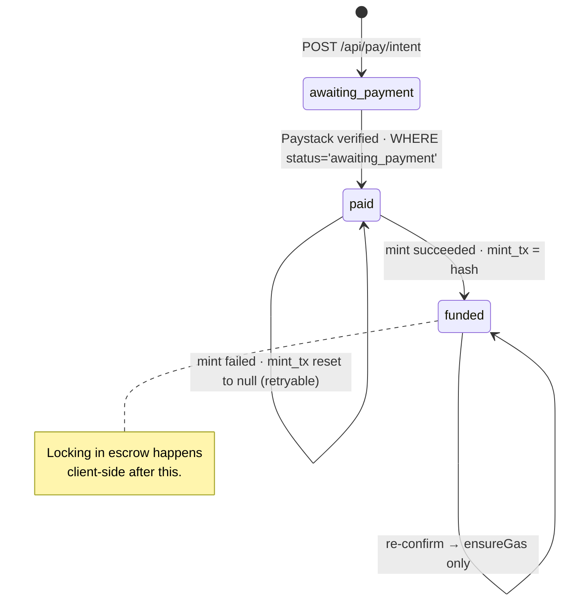

This is the most security-sensitive off-chain code in VeriPay. It converts a **naira card charge** into an **exact on-chain token balance in the buyer's own account**, ready to be locked. Implementation: `src/lib/payments.ts`, `src/lib/paystack.ts`, `src/app/api/pay/{intent,confirm,gas}/route.ts`, `src/app/pay/[handle]/page.tsx`.

<Accordion title="In plain words" icon="lightbulb">
  This is the part that turns "I paid ₦5,000 with my card" into "₦5,000 of digital naira is in my account, ready to lock". It's designed so it can never be tricked into giving out more than was paid, or paying out twice.
</Accordion>

## State machine of a pay intent



| Column | Role |
|---|---|
| `status` | `awaiting_payment` → `paid` → `funded` (`failed` reserved) |
| `paystack_ref` | `UNIQUE` — one charge funds one intent |
| `mint_tx` | `NULL` (not started) · `'pending'` (in flight) · tx hash (done) |
| `gas_topups` | Number of MON top-ups sent for this intent (cap 3) |
| `test_mode` | `true` when no Paystack secret is configured |

## 1. Create intent — `createIntent`

Validations, in order:

| Check | Error |
|---|---|
| Supabase configured | `503 Storage isn't configured.` |
| `amountNgn` rounded to kobo, `≥ 100` | `The minimum is ₦100.` |
| `amountNgn ≤ 5,000,000` | `The maximum is ₦5,000,000.` |
| `item` trimmed to 140 chars, `length ≥ 3` | `Say what you're buying, so you and the seller agree on it.` |
| email regex | `Enter a valid email for your receipt.` |
| `buyerAddress` is `0x` + 40 hex | `401 Sign in first.` |
| seller exists for handle | `404 That seller link doesn't exist.` |
| seller ≠ buyer | `You can't pay your own link.` |

The intent id is 8 characters from an unambiguous alphabet (`ABCDEFGHJKMNPQRSTUVWXYZ23456789`). The reference is `VP-<id>-<Date.now() in base36, uppercased>`.

<Note>
  `createIntent` deliberately **does not** call Paystack's `/transaction/initialize`. The inline popup opens the charge itself under this reference, and Paystack rejects a reference that was already registered ("Duplicate Transaction Reference") — a bug caught by the end-to-end test.
</Note>

## 2. Charge — Paystack inline

The page loads `https://js.paystack.co/v1/inline.js` and calls `PaystackPop.setup({...}).openIframe()` with the public key, email, amount in kobo and the server's reference. The popup's callback hands the reference to the page, which calls `/api/pay/confirm`. **Nothing from the popup is trusted.**

## 3. Confirm — `confirmIntent(id, reference)`

```ts src/lib/payments.ts (simplified)
if (row.status === "funded") return { ok: true, intent, gasReady: await ensureGas(id) }; // idempotent

if (row.status === "awaiting_payment") {
  if (!reference.startsWith(`VP-${id}-`)) return fail("That payment reference doesn't belong to this payment.");
  const r = await verifyTransaction(reference, row.amount_ngn);            // Paystack, server-to-server
  if (!r.ok) return fail(r.error);
  await db.update({ status: "paid", paystack_ref: reference, paid_at })     // optimistic claim
          .eq("id", id).eq("status", "awaiting_payment");
}

const slot = await db.update({ mint_tx: "pending" })                       // single delivery slot
                     .eq("id", id).eq("status", "paid").is("mint_tx", null);
if (!slot) return { ok: true, intent, pending: true };

try {
  const tx = await deliver(intent);                                        // vNGN.mint(buyer, amount)
  await db.update({ status: "funded", mint_tx: tx }).eq("id", id);
  return { ok: true, intent, gasReady: await ensureGas(id) };
} catch {
  await db.update({ mint_tx: null }).eq("id", id);                         // release slot → retryable
  return fail("Your payment went through, but we couldn't finish setting up the escrow. Tap retry — you won't be charged again.", 502);
}
```

<Accordion title="In plain words">
  1. If this payment was already completed, just make sure the buyer has network fuel and stop.
  2. Check the receipt number belongs to *this* payment.
  3. Ask the card company directly whether it really succeeded and for how much.
  4. Mark it "paid" — but only if nobody else already did.
  5. Grab the one-and-only "delivery ticket" for this payment. If someone else has it, stop.
  6. Issue the digital naira. If that fails, hand the ticket back so a retry can try again.
</Accordion>

### Paystack verification — `verifyTransaction`

`GET https://api.paystack.co/transaction/verify/{reference}` with `Authorization: Bearer PAYSTACK_SECRET_KEY`, 10 s timeout, `cache: no-store`. Accepts only if:

- `data.status === "success"`
- `data.currency === "NGN"`
- `data.amount / 100 + 1 ≥ expectedAmountNgn` (₦1 rounding tolerance, never a short payment)

Without a secret key the function returns a labelled **TEST MODE** success (`demo: true`) and the intent is stored with `test_mode = true`.

## 4. Deliver — `deliver`

The server signs `vNGN.mint(buyer, parseUnits(amount.toFixed(2), 6))` with the **minter account** (`PAY_MINTER_PRIVATE_KEY`, falling back to `EXCHANGE_PAYOUT_PRIVATE_KEY`), waits up to 30 s for the receipt and requires `status === "success"`. Transport: viem `http(RPC, { retryCount: 3, timeout: 20_000 })`.

## 5. Gas — `ensureGas`

See [Gas sponsorship](/architecture/gas-sponsorship). In short: if buyer balance `< 0.08 MON` and `gas_topups < 3`, atomically increment `gas_topups` (guarded on the old value) and send `0.15 MON` with up to 3 attempts using a freshly read pending nonce.

## 6. Lock — on the buyer's device

```ts src/app/pay/[handle]/page.tsx (simplified)
if (balance(me) < MIN_GAS /* 0.05 MON */) { await POST("/api/pay/confirm", payRef ? { id } : { buyerAddress, handle }); await poll(balance ≥ MIN_GAS, 8s); }
if (allowance(me, ESCROW) < units) await send(approve(ESCROW, units));
const started = performance.now();
const receipt = await waitForReceipt(await send(createTradeWithToken(seller, item, vNGN, units)));
const tradeId = receipt.logs.find(TradeCreated).topics[1];
```

After the lock the page fires (best-effort) `POST /api/trades/log` and `POST /api/notifications` to the seller.

## 7. Resumption — never charge twice

Two mechanisms:

1. **Client-side:** before opening the card popup, the page reads `vNGN.balanceOf(buyer)`. If it already covers the amount, it sets `funded` and goes straight to `lock()`.
2. **Server-side:** `POST /api/pay/confirm { buyerAddress, handle }` → `resumeForBuyer` finds the latest `funded` intent for that buyer and handle and runs `ensureGas`. It moves no naira.

<Accordion title="In plain words">
  If you paid but got interrupted before the money was locked, the page notices you already have the digital naira and skips straight to locking it. You'll never be asked to pay again for the same order.
</Accordion>

## Failure matrix

| Failure | State left | Recovery |
|---|---|---|
| Card declined | `awaiting_payment` | Pay again |
| Popup closed after charge | `awaiting_payment` | Retry confirm with the same reference (or Paystack webhook — exchange only) |
| Paystack verify unreachable | `awaiting_payment` | Retry confirm |
| Mint reverts / times out | `paid`, `mint_tx = null` | **Retry securing payment** → confirm re-runs delivery |
| Two confirms race | One wins the claim / slot; the other returns `pending: true` | Poll / retry |
| Gas top-up fails | `funded`, `gas_topups` incremented | Retry → `ensureGas` again (until cap) |
| Lock tx fails | `funded`; buyer holds vNGN | **Retry securing payment** → `lock()` only |
| Tab closed after funding | `funded` | Reopen link → resume path |
