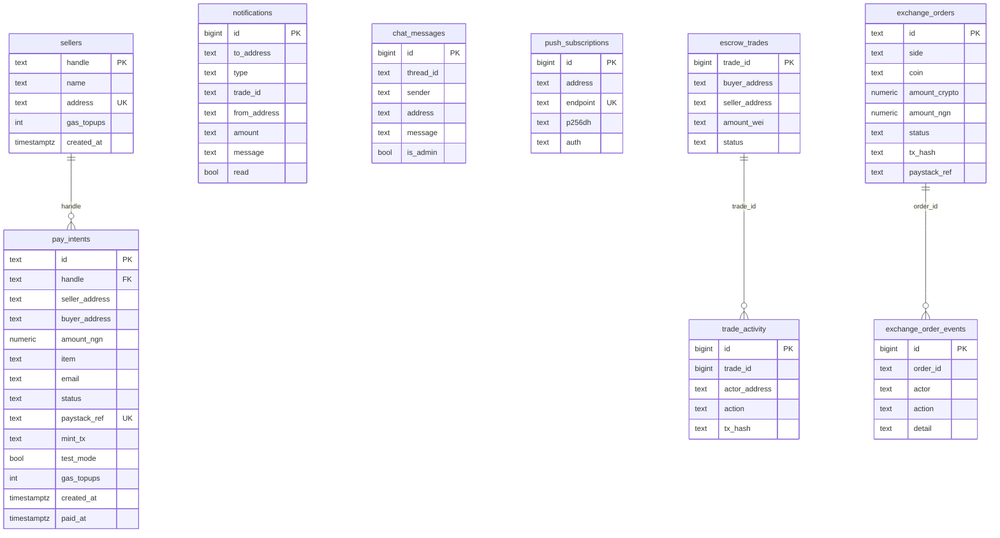

VeriPay stores **money and order status on-chain** and **everything else off-chain** in Supabase Postgres. The schema is in `supabase/schema.sql` and can be applied to a fresh project in one run.

<Accordion title="In plain words" icon="lightbulb">
  Money and the status of each order live on the blockchain. Everything else — shop names, chat messages, notifications — lives in a normal database.
</Accordion>

## Security posture

<Note>
  **Every table has row-level security ON and no policies.** Nothing is readable or writable with the public anon key. The app only talks to the database from the server with the **service-role key** (`src/lib/supabase.ts`), which must never be exposed to the browser.
</Note>

## Entity overview



## Pay links

### `sellers`

| Column | Type | Constraint | Notes |
|---|---|---|---|
| `handle` | text | **PK**, `CHECK (handle ~ '^[a-z0-9][a-z0-9_-]{2,29}$')` | Link name |
| `name` | text | `NOT NULL`, length 2–60 | Shop name |
| `address` | text | `NOT NULL UNIQUE`, `CHECK (address ~ '^0x[a-f0-9]{40}$')` | Lowercase payout address; one link per address |
| `gas_topups` | int | default 0 | Sponsored top-ups sent to this seller (cap 3) |
| `created_at` | timestamptz | default `now()` | |

### `pay_intents`

| Column | Type | Constraint | Notes |
|---|---|---|---|
| `id` | text | **PK** | 8-char id |
| `handle` | text | FK → `sellers(handle)` | |
| `seller_address`, `buyer_address` | text | `NOT NULL` | Lowercased |
| `amount_ngn` | numeric | `> 0` | |
| `item` | text | `NOT NULL` | ≤ 140 chars |
| `email` | text | `NOT NULL` | Receipt email |
| `status` | text | `IN ('awaiting_payment','paid','funded','failed')` | |
| `paystack_ref` | text | **UNIQUE** | One charge funds one payment |
| `mint_tx` | text | | `NULL` / `'pending'` / tx hash |
| `test_mode` | bool | default false | |
| `gas_topups` | int | default 0 | Cap 3 |
| `created_at`, `paid_at` | timestamptz | | |

Index: `pay_intents_buyer_idx (buyer_address)`.

## Messaging

### `notifications`
`to_address` (lowercased), `type IN ('trade','chat')`, `trade_id`, `from_address`, `amount`, `message`, `read`, `created_at`. Index `(to_address, created_at)`.

### `chat_messages`
`thread_id` (trade id, or `ex-<orderId>` for exchange), `sender`, `address`, `message`, `is_admin`, `created_at`. Index `(thread_id, created_at)`.

### `push_subscriptions`
`address`, `endpoint` **UNIQUE**, `p256dh`, `auth`, `created_at`. Index `(address)`.

## Trade mirror (convenience only)

<Warning>
  `escrow_trades` and `trade_activity` mirror on-chain events for analytics. **The chain is the source of truth** — never read order status from these tables in product code.
</Warning>

- `escrow_trades`: `trade_id` PK, buyer/seller, `amount_wei` (base units as text), `metadata`, `status IN ('locked','refund_ready','settled')`, the four tx hashes, timestamps.
- `trade_activity`: append-only log, `action IN ('created','released','refund_approved','refund_claimed')`.

Written by `POST /api/trades/log` (best-effort, never fails the user flow).

## Exchange

### `exchange_orders`

Key columns: `id`, `side IN ('buy','sell')`, `coin`, `amount_crypto`, `amount_ngn`, `exact_amount_ngn`, `rate`, `base_rate`, `spread_percent`, `fee_ngn`, `wallet_address`, bank fields, `status IN ('awaiting_payment','payment_review','verified','confirming','completed','rejected','expired','cancelled')`, `payment_method IN ('transfer','card')`, `settlement_ref`, `quote_expires_at`, `payer_name`, `payer_note`, `tx_hash`, `payout_tx_hash`, `paystack_ref`, `payout_ref`, `admin_note`, `rejection_reason`, and lifecycle timestamps.

Unique partial indexes:

```sql
create unique index exchange_orders_tx_hash_key      on exchange_orders (lower(tx_hash)) where tx_hash is not null;
create unique index exchange_orders_paystack_ref_key on exchange_orders (paystack_ref)   where paystack_ref is not null;
```

### `exchange_order_events`
Audit log per order: `actor`, `action` (e.g. `payment_declared`, `deposit_verified`, `card_charge_verified`, `crypto_released`, `payout_failed`, `expired`), `detail`.

## Analytics

| Table | Purpose |
|---|---|
| `app_users` | One row per wallet: `connect_count`, `last_seen_at` |
| `wallet_events` | Each connect, with user agent |
| `page_views` | Path, wallet (optional), referrer |

Written by `POST /api/track` — fire-and-forget, never breaks the user experience.

## On-chain model

### `Trade` struct (VeriPayEscrow)

| # | Field | Type | Meaning |
|---|---|---|---|
| 0 | `buyer` | address | Payer |
| 1 | `seller` | address | Payee |
| 2 | `amount` | uint256 | Base units of the asset |
| 3 | `released` | bool | Seller has been paid (fully or partly) |
| 4 | `sellerApprovedRefund` | bool | Seller consented to refund |
| 5 | `metadata` | string | Item description |
| 6 | `createdAt` | uint64 | Block timestamp at creation |
| 7 | `autoReleaseAt` | uint64 | `createdAt + autoReleaseDelay` |
| 8 | `disputed` | bool | Dispute raised |
| 9 | `refunded` | bool | Buyer has been repaid (fully or partly) |
| 10 | `feeBps` | uint16 | Fee snapshotted at creation |
| 11 | `token` | address | `address(0)` = MON, else ERC-20 |

See [Storage and types](/contracts/escrow/storage-and-types).

### Envio entities

`TradeRecord` and `AddressReputation` — see [Reputation](/architecture/reputation#schema).

## Identifier conventions

- **Addresses** are lowercased in every table and in Envio ids.
- **Trade ids** are `uint256` on-chain, `bigint` in `escrow_trades`, text in `notifications.trade_id` / `chat_messages.thread_id`, and displayed as `#0009` (padded to 4).
- **Amounts**: vNGN/AUSD have 6 decimals; MON has 18. `formatTradeAmount()` renders by asset.
