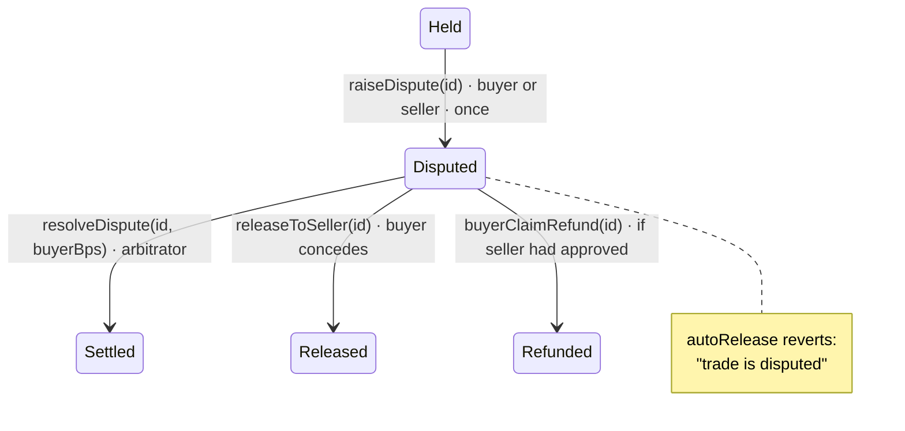

## Why disputes exist

The original contract could only settle if both parties agreed — buyer releases, or seller approves a refund. In a disagreement, money sat in the contract **forever**, recoverable by nobody. `VeriPayEscrow` adds an escape hatch: **either party can raise a dispute**, and an **arbitrator** can split the funds any way between them.

<Accordion title="In plain words" icon="lightbulb">
  The first version of VeriPay had no way to settle a disagreement — the money would be stuck forever. Now either side can ask for a review, and a reviewer decides who gets what.
</Accordion>

## Lifecycle



## Raising a dispute

```solidity
function raiseDispute(uint256 _id) external {
    Trade storage t = trades[_id];
    require(msg.sender == t.buyer || msg.sender == t.seller, "not a party to this trade");
    _requireOpen(t);
    require(!t.disputed, "already disputed");
    t.disputed = true;
    emit DisputeRaised(_id, msg.sender);
}
```

The UI (**Report a problem with this order → Freeze & request review**) then posts a system chat message so an agent sees the case in the admin console.

## Resolving a dispute

```solidity
function resolveDispute(uint256 _id, uint16 _buyerBps) external nonReentrant {
    require(msg.sender == arbitrator, "only the arbitrator can resolve");
    require(_buyerBps <= BPS_DENOMINATOR, "share out of range");
    Trade storage t = trades[_id];
    _requireOpen(t);
    require(t.disputed, "trade is not disputed");

    uint256 toBuyer  = (t.amount * _buyerBps) / BPS_DENOMINATOR;
    uint256 toSeller = t.amount - toBuyer;
    t.refunded = toBuyer > 0;
    t.released = toSeller > 0;
    _payout(_id, toBuyer, toSeller);          // fee only on toSeller
    emit DisputeResolved(_id, toBuyer, toSeller);
}
```

| `_buyerBps` | Buyer gets | Seller gets (before 1% fee) | Flags after |
|---|---|---|---|
| `10000` | 100% | 0 | `refunded` |
| `7500` | 75% | 25% | `refunded`, `released` |
| `5000` | 50% | 50% | `refunded`, `released` |
| `0` | 0 | 100% | `released` |

<Accordion title="In plain words">
  The reviewer picks a percentage for the buyer — anything from 0 to 100%. The seller gets the rest, minus VeriPay's 1% on the seller's part only. A full refund costs the buyer nothing.
</Accordion>

<Note>
  Rounding: `toBuyer` rounds **down**, so any sub-unit remainder goes to the seller's side.
</Note>

## Admin tooling — ArbitrationPanel

`src/components/ArbitrationPanel.tsx`, in **Admin console → Disputes**:

1. Detects the contract version; on v1 it shows that disputes aren't supported (rather than an empty list).
2. Reads `arbitrator()` and compares it to the connected wallet.
3. Scans the latest **150** trades (`SCAN_LIMIT`) for `disputed && !released && !refunded`.
4. Shows each case: parties, amount (asset-aware), description, link to the order chat.
5. Lets the arbitrator pick a split and calls `resolveDispute(id, buyerBps)` through thirdweb.

<Warning>
  The admin passcode only opens the console. **Settling a dispute requires the arbitrator wallet** to sign — the passcode alone cannot move funds.
</Warning>

## Process guidance for arbitrators

<Steps>
  <Step title="Read the on-chain description">The `metadata` the buyer typed is the agreed item.</Step>
  <Step title="Read the order chat">Delivery promises, evidence, refund offers.</Step>
  <Step title="Ask for evidence">Photos, tracking, unboxing video, receipts.</Step>
  <Step title="Decide a split">Full refund for non-delivery; full release for buyer's remorse after correct delivery; partial for damaged or partially correct items.</Step>
  <Step title="Record reasoning in chat">So both parties understand the decision.</Step>
</Steps>

## Centralisation

Today the arbitrator is **a single address** (the founder's wallet, also the owner). This is a known centralisation point, disclosed in [Known limitations](/security/known-limitations). The roadmap moves to multi-party review (multisig or staked jurors). The contract already supports rotating the arbitrator with `setArbitrator`.
