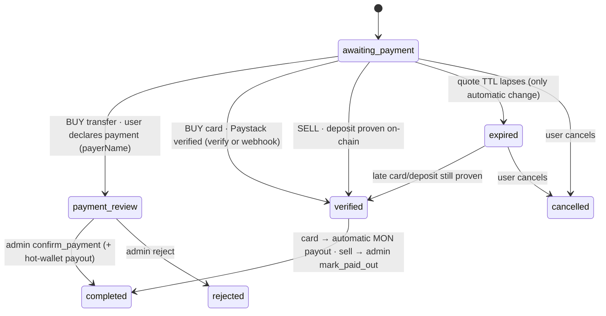

The exchange (`/exchange`, pre-hackathon) is a naira ⇄ crypto on/off-ramp whose job is to make escrow reachable for people who don't own crypto. Code: `src/lib/pricing.ts`, `src/lib/exchangeStore.ts`, `src/lib/chainVerify.ts`, `src/lib/paystack.ts`, `src/app/api/exchange/**`, `src/app/api/admin/orders`.

<Accordion title="In plain words" icon="lightbulb">
  This is VeriPay's "currency exchange counter" for crypto. It works out fair prices from live markets, locks your price for 15 minutes, and checks every payment before releasing anything.
</Accordion>

## Pricing model

A naira price is the product of two independent legs:

```text
mid_ngn(coin) = usd(coin) × ngn_per_usd
buyNgn        = mid_ngn × (1 + spread)
sellNgn       = mid_ngn × (1 − spread)
```

| Leg | Primary source | Fallbacks |
|---|---|---|
| coin → USD | Binance spot `/api/v3/ticker/price` (BTC, ETH, SOL) | CoinGecko `simple/price` (MON, USDT and any Binance miss) → constant |
| USD → NGN | **Median** of Bybit P2P USDT/NGN online ads (top 20, prices filtered to 100–100,000) | `EXCHANGE_NGN_USD_RATE` env (takes precedence if set) → CoinGecko USDT/NGN → ₦1,400 |

<Accordion title="Why Bybit P2P and not the official rate">
  CoinGecko's NGN price tracks the official CBN rate. The rate Nigerians actually transact at is the P2P street rate, which ran ~2% higher. Quoting the official rate while sourcing liquidity at the street rate loses money on **every** order. The median (not minimum) means one troll ad can't move the price.

  **In plain words:** VeriPay prices off the rate people really trade at, so it doesn't lose money on every order.
</Accordion>

### Supported coins

| Symbol | Binance pair | CoinGecko id | Fallback USD |
|---|---|---|---|
| MON | — | `monad` | 0.021 |
| USDT | — | `tether` | 1 |
| BTC | `BTCUSDT` | `bitcoin` | 64,000 |
| ETH | `ETHUSDT` | `ethereum` | 1,860 |
| SOL | `SOLUSDT` | `solana` | 74 |

`snapshot.live` is `true` only if no leg used a fallback constant.

## Caching — stale-while-revalidate

| Age of snapshot | Behaviour |
|---|---|
| `< 8 s` (`CACHE_TTL_MS`) | Serve |
| `8 s – 120 s` | Serve immediately **and** refresh in the background |
| `> 120 s` (`CACHE_HARD_MAX_MS`) or none | Block on a fresh fetch |

In-flight refreshes are de-duplicated on `globalThis.__vpPricingInflight`. If a refresh fails and a previous snapshot exists, the stale snapshot is served.

<Accordion title="Why SWR instead of a plain TTL">
  A blocking cache with TTL equal to the client poll interval meant nearly every request hit an expiry and paid 1–3 s of upstream latency. SWR returns in ~3 ms in production while keeping prices within seconds of live.
</Accordion>

## Quotes and limits

| Setting | Default | Env | Clamp |
|---|---|---|---|
| Spread | 3.5% | `EXCHANGE_SPREAD_PERCENT` | 0–25 |
| Quote TTL | 15 min | `EXCHANGE_QUOTE_TTL_MINUTES` | 1–120 |
| Min order | ₦1,000 | `EXCHANGE_MIN_NGN` | 100–1,000,000 |
| Max order | ₦5,000,000 | `EXCHANGE_MAX_NGN` | 1,000–1,000,000,000 |

The browser sends only `{ side, coin, amountNgn | amountCrypto, walletAddress, paymentMethod, bank? }`. **Price, fee and crypto amount are computed server-side** from the snapshot.

### Card fee pass-through

```ts
cardFeeNgn(amount) = min(round2(amount × 0.015 + (amount ≥ 2500 ? 100 : 0)), 2000)
```

For card buys, `exactAmountNgn = spend + cardFee`, so the processor's fee never eats the spread.

### Kobo-suffix reconciliation

For bank-transfer buys, `exactAmountNgn = withUniqueKobo(spend)` — e.g. **₦20,000.14** instead of ₦20,000. Two customers paying "₦20,000" in the same minute are indistinguishable on a bank statement; ₦20,000.14 and ₦20,000.83 are not.

## Order state machine



**Nothing releases on a timer.** Expiry is the only automatic transition and it only moves an order backwards. Every admin transition goes through `transitionOrder(id, allowedFrom[], patch)`, which puts the allowed prior statuses in the SQL `WHERE` clause, so concurrent double-clicks can't pay twice.

## Sell-side deposit verification — `verifyDeposit`

The server reads the transaction from a Monad node and checks:

1. Hash format `^0x[a-fA-F0-9]{64}$`.
2. Transaction exists (else retryable: *"We can't find that transaction on Monad yet…"*).
3. Receipt `status == success` and confirmed.
4. `to` == VeriPay's deposit address (`EXCHANGE_MERCHANT_ADDRESS`).
5. `from` == the order's wallet.
6. `value ≥ expected × 0.999` (dust tolerance).

A partial unique index on `lower(tx_hash)` prevents one deposit settling multiple orders. A real, confirmed transaction that wasn't sent to VeriPay is rejected.

## Card verification and webhook

- `POST /api/exchange/card/init` initialises Paystack with the **stored** `exactAmountNgn` (never the request body) and reference `VP-<orderId>-<ts36>`.
- `POST /api/exchange/card/verify` re-verifies with Paystack and transitions to `verified` (unique index on `paystack_ref`). With a hot wallet configured it pays out MON immediately → `completed`.
- `POST /api/exchange/card/webhook` validates `x-paystack-signature` = HMAC-SHA512(raw body, secret), handles `charge.success`, rejects underpayment, and settles the same way — the safety net if the customer closes the tab.

## Payout

`payoutCrypto(order)` sends **MON only** from `EXCHANGE_PAYOUT_PRIVATE_KEY`, guarded by an in-process in-flight set and the order's `payoutTxHash`. Other coins and all naira payouts are settled manually by an admin.

## Admin fulfilment queue

`GET /api/admin/orders` returns every order with **rate drift** (current vs locked rate, %), and queue aggregates: actionable count, orders awaiting buyer funds, ₦ to collect, ₦ to pay out. Actions: `confirm_payment`, `mark_paid_out`, `reject`. See [Admin API](/api/admin).
