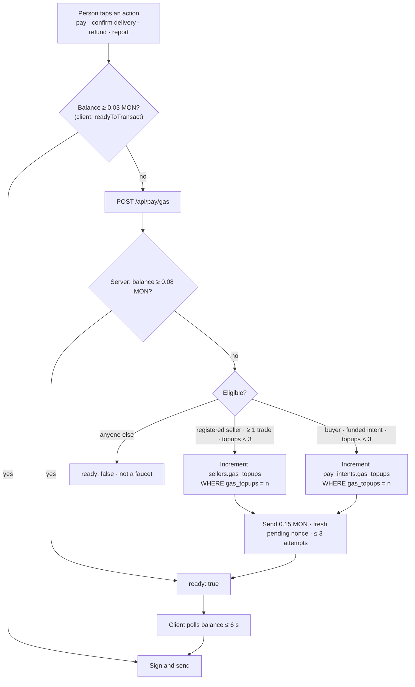

Fingerprint accounts start with **zero MON**, so they can't pay gas. VeriPay sponsors gas by sending small **native MON top-ups** from the server's minter wallet to eligible accounts, just before they need to transact. There is no paymaster or account abstraction; the user's EOA pays its own gas with sponsored MON.

<Accordion title="In plain words" icon="lightbulb">
  Every action on the blockchain costs a tiny fee in MON. New users have none. So just before you need it, VeriPay quietly puts a little MON in your account — enough for your actions — with limits so nobody can abuse it.
</Accordion>

## Decision flow



## Parameters

| Constant | Value | Where | Purpose |
|---|---|---|---|
| `MIN_GAS` (client) | 0.03 MON | `src/lib/gas.ts` | Enough for one escrow action with headroom |
| `MIN_GAS` (pay page) | 0.05 MON | `src/app/pay/[handle]/page.tsx` | Enough for `approve` + lock before signing |
| `GAS_FLOOR` (server) | 0.08 MON | `src/lib/payments.ts` | Below this, top up |
| `GAS_TOPUP` | 0.15 MON | `src/lib/payments.ts` | Amount sent per top-up |
| `MAX_GAS_TOPUPS` | 3 | `src/lib/payments.ts` | Per intent and per seller |
| Send attempts | 3, 1.5 s apart | `sendGas` | Retries with a fresh `pending` nonce |
| Client poll | 6 × 1 s (`readyToTransact`), 8 × 1 s (pay page) | | Wait for top-up to land |

Two escrow transactions (approve + lock) cost about 0.03 MON at observed prices, so one top-up comfortably covers a payment and the follow-up action.

## Eligibility

| Account type | Condition | Counter |
|---|---|---|
| **Card-funded buyer** | Has a `pay_intents` row with `status = 'funded'` and `gas_topups < 3` | `pay_intents.gas_topups` |
| **Registered seller** | Has a `sellers` row with `gas_topups < 3` **and** `getReputation(address).totalTrades > 0` | `sellers.gas_topups` |
| Everyone else | — | refused |

<Accordion title="Why not just sponsor everyone?">
  An unconditional top-up endpoint is a free faucet: scripts would drain the minter wallet. Tying eligibility to a **verified card payment** (buyers) or a **real on-chain order** (sellers) makes abuse cost real money, and the per-entity cap bounds the worst case.

  **In plain words:** if it were free for anyone, bots would drain it. Only real buyers and real sellers qualify, and only a few times.
</Accordion>

## Concurrency safety

The counter is incremented **before** sending, with the previous value in the `WHERE` clause:

```ts
const { data: claimed } = await supabase.from("pay_intents")
  .update({ gas_topups: row.gas_topups + 1 })
  .eq("id", id).eq("gas_topups", row.gas_topups)   // compare-and-swap
  .select("id").maybeSingle();
if (!claimed) return false;                        // someone else is already sending
```

Two simultaneous requests read the same `n`; only one update matches; the other returns `ready: false` and the client simply polls the balance.

## Retry with fresh nonce

`sendGas` reads `getTransactionCount({ blockTag: "pending" })` on every attempt, so a stuck or dropped first attempt doesn't cause a nonce collision. After each failed attempt it re-checks the recipient's balance — if the earlier transaction landed after all, it returns success.

<Note>
  **History:** the first version was a single best-effort send right after minting. It failed silently in production: a buyer was charged, held their naira, and then couldn't lock it (*"Signer had insufficient balance"*). Sponsorship is now retried, resumable and re-run on every confirmation. **Don't make it best-effort again.**
</Note>

## Operating the sponsor wallet

- It's the same key as the vNGN minter (`PAY_MINTER_PRIVATE_KEY`, demo wallet `0xeb1B…fd06`).
- Each new buyer costs ≈ 0.15 MON. Keep it funded from the Monad testnet faucet.
- Check readiness with `GET /api/pay/intent` → `deliveryAddress`.
