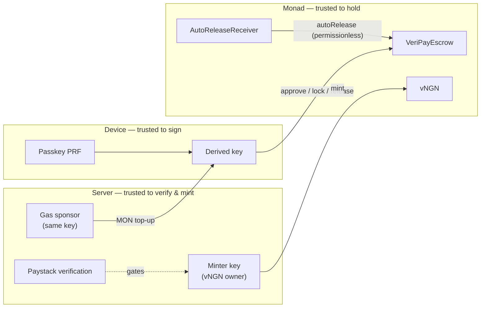

## The four layers

| Layer | What lives there | Trusted with | **Not** trusted with |
|---|---|---|---|
| **The person's device** | The passkey and the account derived from it | Signing the person's own transactions; the private key never leaves the device | Claims about payment success, prices or amounts |
| **VeriPay's server** | Seller links, payment intents, card verification, the delivery (minter) wallet | Confirming card charges and issuing the matching test naira; sponsoring gas within caps | **Holding escrowed money** — it never does |
| **Monad** | `VeriPayEscrow`, `vNGN`, `AutoReleaseReceiver` | Holding the money and enforcing the rules; nobody, including VeriPay, can override it | — |
| **Sponsor infrastructure** | Mera, Alchemy, Envio, Chainlink CRE | Sign-in, network access, fast reputation reads, scheduled automation | Custody; any of them failing degrades, but doesn't break, safety |

<Accordion title="In plain words" icon="lightbulb">
  - **Your phone** holds your key and signs your actions. It's not trusted to say "I paid".
  - **VeriPay's server** checks card payments and hands out the matching digital naira. It never holds your locked money.
  - **The blockchain** holds the money and enforces the rules. Nobody can override it.
  - **Helper services** make things fast and convenient. If one fails, things get slower, not less safe.
</Accordion>

## Trust boundary diagram

## Keys in the system

| Key / role | Held by | Powers | Cannot |
|---|---|---|---|
| **User account** | User's device (derived from passkey) | Approve tokens, create trades, release, claim refunds, raise disputes | Act on other people's trades |
| **Escrow owner** | Founder wallet `0xEfD0…1aBA` | `setFeeBps` (≤ 5%), `setArbitrator`, `setFeeRecipient`, `setAutoReleaseDelay` (1–90 d), `withdrawFees`, `transferOwnership` | Move escrowed funds; raise fee above 5%; change fees on open trades |
| **Arbitrator** | Founder wallet (currently same as owner) | `resolveDispute` on disputed trades | Touch undisputed trades; give > 100% |
| **Fee recipient** | Founder wallet | Receives withdrawn fees | — |
| **Minter / delivery wallet** | Server env `PAY_MINTER_PRIVATE_KEY` (testnet only) | Mint vNGN; send MON gas top-ups | Touch escrow funds |
| **Exchange hot wallet** | Server env `EXCHANGE_PAYOUT_PRIVATE_KEY` | Send MON for exchange buy orders | Touch escrow funds |
| **Receiver owner** | Demo wallet | `setForwarderAddress` etc. on `AutoReleaseReceiver` | Anything beyond what `autoRelease` already allows anyone |
| **Chainlink forwarder** | Chainlink | Deliver signed reports to the receiver | Bypass the escrow's own `autoRelease` checks |
| **Supabase service role** | Server env `SUPABASE_SERVICE_ROLE_KEY` | Read/write all tables | Touch on-chain funds |
| **Admin passcode** | Operator | Admin console (exchange fulfilment, chat, stats) | Touch escrow funds (arbitration requires the arbitrator wallet) |

<Warning>
  **Compromise analysis.** A leaked minter key could mint unlimited vNGN and drain the minter's MON. On testnet vNGN is worthless; in production this role must belong to a regulated stablecoin issuer, **not** VeriPay. No single VeriPay key can move money already locked in escrow.
</Warning>

## What happens if a layer fails

| Failure | Effect | Safety impact |
|---|---|---|
| Envio down | Reputation falls back to direct chain scan (slower) | None |
| Alchemy down | Set `NEXT_PUBLIC_MONAD_RPC_URL` to another provider or the public node | None |
| Supabase down | Seller lookups, new payments, chat and notifications fail | Locked funds unaffected; release/refund/dispute still work from any client that can call the contract |
| Paystack down | New card payments fail | None |
| VeriPay server down | No new pay-link payments | Locked funds unaffected |
| Chainlink CRE down | No automatic releases | Sellers can still call `autoRelease` themselves (**Collect my payment**) |
| VeriPay disappears entirely | Front-end gone | Funds remain in the contract; buyers can still `releaseToSeller`, sellers `autoRelease`, via any EVM tool |
