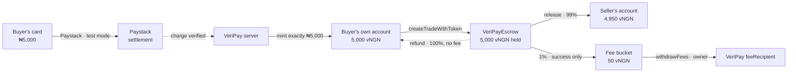
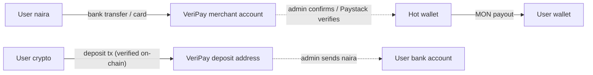

## The path of ₦5,000



## Custody at each step

| Moment | Where the value is | Who can move it |
|---|---|---|
| Card charged | Paystack settlement balance (fiat) | Paystack / merchant account |
| After `mint` | **Buyer's own account** (vNGN) | Only the buyer (their passkey) |
| After `createTradeWithToken` | **VeriPayEscrow** | Only the contract's rules: buyer release, seller-approved refund, arbitrator on dispute, anyone after window |
| After release | Seller's account (99%) + `accruedFees[vNGN]` (1%) | Seller; owner for fees only |
| After refund | Buyer's account (100%) | Buyer |

<Accordion title="In plain words" icon="lightbulb">
  VeriPay's server only ever gives digital naira **to the buyer's own account**. It's the buyer's fingerprint that locks it into the safe. From that moment, only the rules of the safe decide where it goes. VeriPay can only ever collect its 1% from orders that finished successfully.
</Accordion>

## Key properties

- **The server only ever puts money into the buyer's own account.** The buyer's passkey is what locks it. VeriPay never has custody of an order.
- **The fee is taken only when a seller is paid.** Refunds are always returned in full.
- **`withdrawFees` can move only the fee bucket.** There is no function that lets the owner touch money held for open orders. `escrowedBalance(token) = balanceOf(this) − accruedFees[token]` is customer money that no admin path can reach.
- **vNGN is a test token VeriPay deployed** to stand in for a regulated naira stablecoin on testnet. In production this slot is filled by a licensed stablecoin; the contract already accepts any ERC-20, so nothing on-chain changes.

## Accounting identity

For every asset `token`, at all times:

```text
token.balanceOf(escrow) = Σ amount of open trades in token  +  accruedFees[token]
```

(For native MON, `address(escrow).balance` replaces `balanceOf`; `receive()` reverts, so MON can only enter via `createTrade`.)

<Accordion title="Why this identity holds">
  - `createTrade*` adds `amount` to the balance and creates an open trade of `amount`.
  - `_payout` removes an open trade's full `amount` from the open set and sends `toBuyer + (toSeller − fee)` out, adding `fee` to `accruedFees` — net change zero on both sides of the identity.
  - `withdrawFees` reduces both the balance and `accruedFees[token]` by the same amount.
  - Stray native transfers revert. (A plain ERC-20 `transfer` directly to the contract would add an unaccounted surplus, which only makes the left side larger; it can't be withdrawn by anyone.)

  **In plain words:** the safe always contains exactly the money for unfinished orders plus the collected fees — nothing missing.
</Accordion>

## Exchange money flow (separate product)

The exchange is custodial by nature (VeriPay holds crypto and naira inventory) and is kept separate from escrow:



See [Exchange engine](/architecture/exchange-engine).
