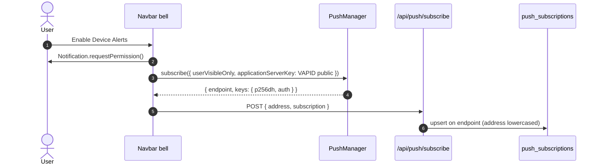

## Components

| Piece | File | Role |
|---|---|---|
| Notifications API | `src/app/api/notifications/route.ts` | `GET` list (50 newest), `POST` create (+ push), `PATCH` mark read |
| Bell UI | `src/components/Navbar.tsx` | Polls `GET` every 20 s via `usePolling`; device-alert toggle |
| Push sender | `src/lib/push.ts` | `sendPushToAddress()` via `web-push`, prunes 404/410 |
| Push client | `src/lib/pushClient.ts` | Permission, `PushManager.subscribe`, POST subscription |
| Subscriptions API | `src/app/api/push/{subscribe,unsubscribe,resubscribe}` | Upsert/delete rows in `push_subscriptions` |
| Service worker | `public/sw.js` | Offline fallback, `push`, `notificationclick`, `pushsubscriptionchange` |
| Manifest | `src/app/manifest.ts` | Served at `/manifest.webmanifest` |
| Install UI | `src/app/install/page.tsx`, `src/components/InstallPrompt.tsx` | Per-platform guide; `beforeinstallprompt` banner |
| Registration | `src/components/ServiceWorkerRegister.tsx` | Registers `sw.js` (production only) |

<Accordion title="In plain words" icon="lightbulb">
  VeriPay can show alerts inside the app, send real phone notifications, and be installed like an app. These are the pieces that make that work.
</Accordion>

## Push subscription flow



- One row per browser installation (`endpoint` is `UNIQUE`); re-subscribing just reassigns the address.
- Toggle states: *Enable Device Alerts* → *Device Alerts On*; *Blocked in Browser Settings* when permission is `denied`; hidden when unsupported.

## Send path

`POST /api/notifications` inserts the row and then fires `sendPushToAddress()` **without awaiting** (`.catch(() => {})`). The payload is `{ title, body, url }`:

| Type | Title | Body |
|---|---|---|
| `trade` (naira amount) | Payment secured for you | A buyer just locked ₦… for you. Deliver, and it's yours. |
| `trade` (numeric MON amount) | Payment secured for you | `0x1234ab…cdef12` opened a trade for N MON |
| `chat` | New Message · Trade #00id | the message |

## Service worker

```js public/sw.js (essentials)
const CACHE_NAME = "veripay-shell-v1";
// install: cache /offline.html · activate: delete old caches
self.addEventListener("fetch", (e) => {
  if (e.request.mode !== "navigate") return;                 // never touch /api/*
  e.respondWith(fetch(e.request).catch(() => caches.match("/offline.html")));
});
self.addEventListener("push", (e) => { /* showNotification(title, { body, icon, badge, data: { url } }) */ });
self.addEventListener("notificationclick", (e) => { /* focus a matching window or openWindow(url) */ });
self.addEventListener("pushsubscriptionchange", (e) => { /* resubscribe + POST /api/push/resubscribe */ });
```

<Warning>
  **Deliberately not cached:** pricing, escrow reads, chat and orders. A stale price or order status served offline is a financial bug, not a UX nit. Don't add API caching to the service worker.
</Warning>

## Manifest

```json
{
  "name": "VeriPay — Escrow & Exchange",
  "short_name": "VeriPay",
  "start_url": "/",
  "display": "standalone",
  "background_color": "#ffffff",
  "theme_color": "#000000",
  "icons": [192, 512 any + maskable]
}
```

Icons are generated from `src/app/icon.svg` into `public/icons/` (`icon-192/512`, `maskable-192/512`, `apple-touch-icon`).

## Configuration

| Variable | Purpose |
|---|---|
| `NEXT_PUBLIC_VAPID_PUBLIC_KEY` | Browser subscription key |
| `VAPID_PRIVATE_KEY` | Server signing key |
| `VAPID_SUBJECT` | Contact URI (default `mailto:support@veripay.store`) |

Generate with `npx web-push generate-vapid-keys`. Without both keys, push silently no-ops; the bell still works.
