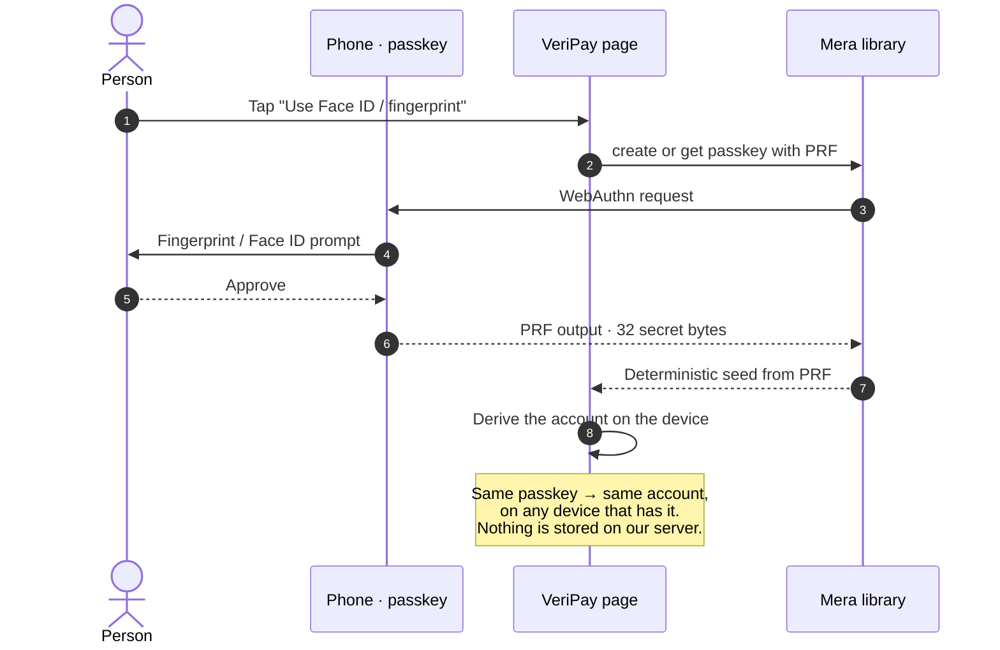
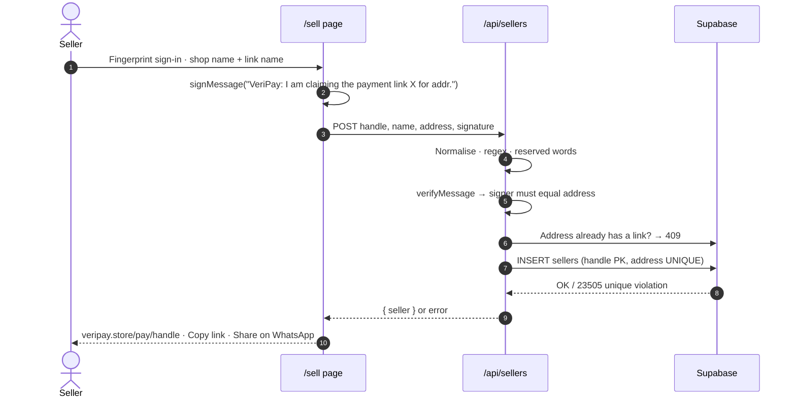
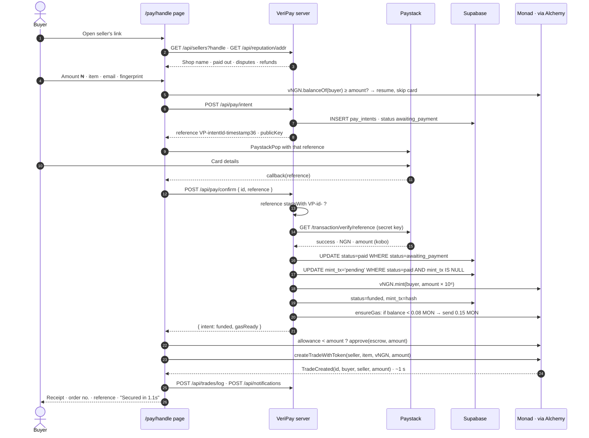
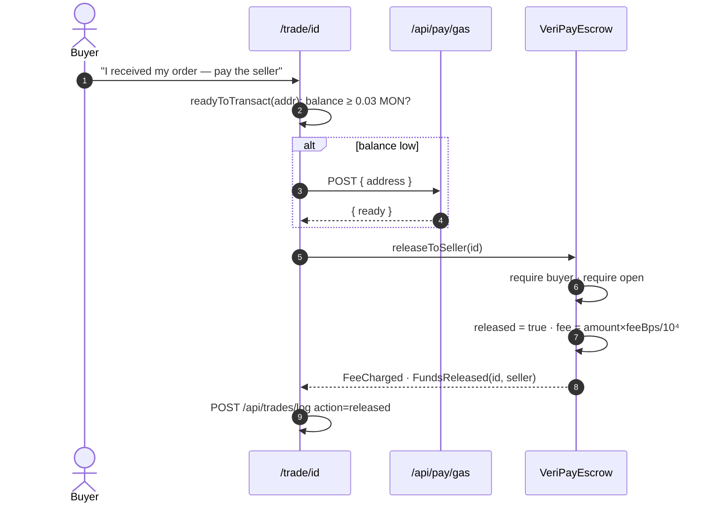
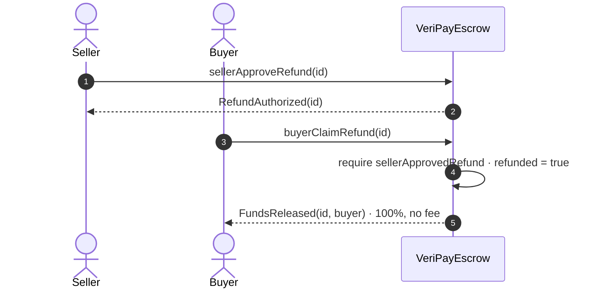
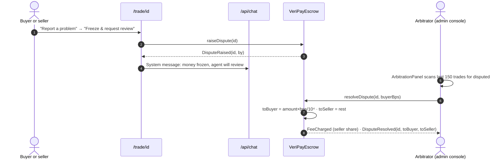
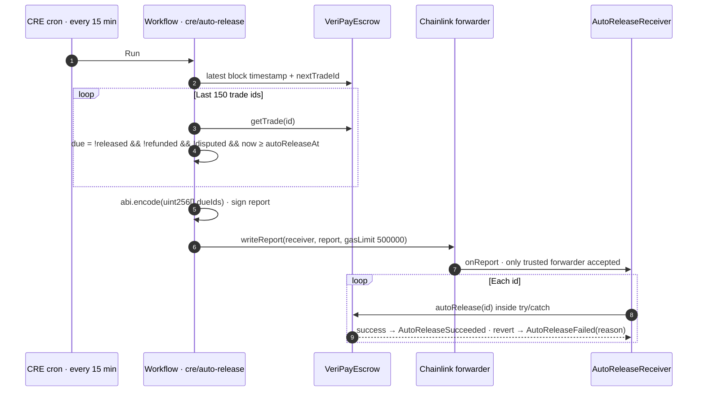
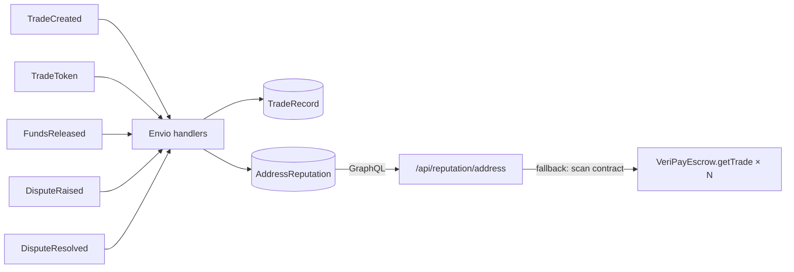

Each diagram below is drawn from the actual code paths. File names are given so you can check them.

## 1. Sign-in (Mera passkey)

`src/lib/mera.ts`, `src/lib/useSignIn.ts` — see [Passkey accounts](/architecture/passkey-accounts).

<Accordion title="In plain words" icon="lightbulb">
  You approve with your fingerprint; your phone produces a secret; VeriPay's page turns that secret into your account, on your phone. Nothing secret goes to VeriPay.
</Accordion>

## 2. Seller claims a payment link

`src/lib/sellers.ts`, `src/lib/sellerShared.ts`, `src/app/api/sellers/route.ts`.

## 3. Buyer pays — the core money path

### Guards and what they prevent

| Step | Guard | Stops |
|---|---|---|
| intent | Seller address looked up from handle server-side | Browser redirecting funds to another address |
| intent | `seller.address === buyer` rejected | Paying your own link to farm reputation |
| confirm | Reference must start with `VP-<intent id>-` | Paying ₦2,500 and presenting that receipt for a ₦50,000 order |
| confirm | Paystack asked directly, server to server | A tampered browser claiming a payment that never happened, or paid less |
| confirm | `paidNgn + 1 ≥ expected`, `currency == NGN`, `status == success` | Short payments, wrong currency, failed charges |
| confirm | Status guard in SQL `WHERE` | Two simultaneous confirmations both delivering |
| confirm | `paystack_ref` is `UNIQUE` | One charge funding two intents |
| deliver | Single delivery slot (`mint_tx = 'pending'`) | Minting twice if a retry races the first attempt |
| deliver | Mint exactly the verified intent amount | Any mismatch between charged and locked |
| deliver | On failure, slot released (`mint_tx = null`) | A transient error permanently stranding a paid buyer |
| gas | Counted before sending, guarded on prior count; cap 3 | Becoming a free faucet; concurrent double top-ups |
| page | Resume when `vNGN.balanceOf ≥ amount` | Charging a buyer twice after an interrupted lock |

`src/lib/payments.ts`, `src/app/pay/[handle]/page.tsx`, `src/app/api/pay/*` — see [Card to escrow](/architecture/card-to-escrow).

## 4. Release (buyer confirms delivery)

## 5. Refund

## 6. Dispute and arbitration

See [Disputes and arbitration](/architecture/disputes-and-arbitration).

## 7. Automatic release (Chainlink CRE)

See [Auto-release](/architecture/auto-release).

## 8. Reputation update

See [Reputation](/architecture/reputation).
