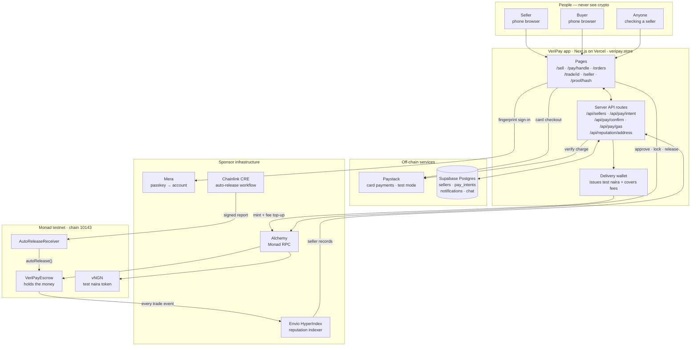

VeriPay is a **Next.js 16 (App Router) application** deployed on Vercel, backed by **Supabase Postgres** for off-chain state, integrating **Paystack** for card acquiring, and settling on **Monad testnet** through three contracts. Identity is a **passkey-derived EOA**; reads and writes go through **Alchemy RPC**; reputation is served by an **Envio HyperIndex** deployment; liveness is provided by a **Chainlink CRE** cron workflow.

<Accordion title="In plain words" icon="lightbulb">
  VeriPay is a website (built with Next.js) that talks to a database (Supabase) for ordinary information like shop names, a card company (Paystack) for payments, and the Monad blockchain where the money is actually held. Some helper services make sign-in easy (Mera), make lookups fast (Envio), connect to the blockchain (Alchemy) and run automatic payouts (Chainlink).
</Accordion>

## System diagram

**Reading the diagram:** people only ever touch the app's pages. The app's server talks to Paystack and the database. Every blockchain read and write goes to Monad through Alchemy. The escrow contract is where the money lives; Envio turns its events into seller records; Chainlink's workflow pays sellers whose buyers went silent.

## Components

| Component | Technology | Responsibility | Code |
|---|---|---|---|
| Web app (client) | Next.js 16, React 19, Tailwind 4, thirdweb v5, viem | UI, passkey derivation, transaction signing, polling | `src/app/**/page.tsx`, `src/components/` |
| Web app (server) | Next.js route handlers on Vercel (Node runtime) | Seller claims, payment intents, Paystack verification, minting, gas sponsorship, reputation, notifications | `src/app/api/**`, `src/lib/` |
| Database | Supabase Postgres, RLS on, service-role only | Sellers, intents, notifications, chat, push subscriptions, exchange orders, analytics, trade mirror | `supabase/schema.sql` |
| Card acquiring | Paystack inline JS + REST verify + webhook | Naira card charges | `src/lib/paystack.ts` |
| Identity | `@category-labs/mera` + `@scure/bip32/bip39` | Passkey PRF → secp256k1 key | `src/lib/mera.ts` |
| RPC | Alchemy Monad testnet (fallback: public node) | All chain I/O | `src/lib/monad.ts` |
| Escrow | Solidity 0.8.24 | Custody and settlement rules | `contracts/VeriPayEscrow.sol` |
| Test naira | Solidity 0.8.24 ERC-20 | On-chain naira representation on testnet | `contracts/test/VeriPayTestNaira.sol` |
| Automation | Chainlink CRE TS SDK + receiver contract | Scheduled `autoRelease` | `cre/`, `contracts/cre/` |
| Indexer | Envio HyperIndex (hosted) | Event-sourced reputation over GraphQL | `indexer/` |
| Push | Web Push (VAPID) + service worker | Device notifications | `src/lib/push.ts`, `public/sw.js` |

## Design principles

<AccordionGroup>
  <Accordion title="1. The chain is the source of truth for money and status" icon="link">
    Order status is always read from the contract (`readTrade`), never from the database. `escrow_trades` / `trade_activity` exist only as a convenience mirror for analytics.

    **In plain words:** whatever the blockchain says is the truth. VeriPay's database never overrides it.
  </Accordion>
  <Accordion title="2. Never trust the browser about money" icon="shield">
    Prices, amounts, payout destinations and payment success are decided server-side. The browser sends *intent* (which seller handle, how much naira), never a rate, an address to pay, or a "paid" flag that is trusted.

    **In plain words:** the website on your phone can be tampered with, so anything involving money is double-checked by VeriPay's server.
  </Accordion>
  <Accordion title="3. Concurrency guards live in the database" icon="lock">
    Every state transition that moves value uses an optimistic-concurrency update with the expected prior state in the SQL `WHERE` clause (`.eq("status", "awaiting_payment")`, `.is("mint_tx", null)`, `.eq("gas_topups", n)`). A losing concurrent request matches zero rows and does nothing.

    **In plain words:** if two requests try to do the same thing at the same time, only one can win. Double-clicks can't pay twice.
  </Accordion>
  <Accordion title="4. Every external dependency has a fallback" icon="life-buoy">
    Envio → direct chain scan. Alchemy → public RPC. Binance → CoinGecko → constant. Bybit P2P → CoinGecko → constant. Paystack keys missing → labelled test mode.

    **In plain words:** if a helper service goes down, VeriPay keeps working, just a bit slower.
  </Accordion>
  <Accordion title="5. Blockchain invisible on consumer surfaces" icon="eye-off">
    No addresses, "MON", "escrow" or "wallet" on `/pay`, `/sell`, `/orders`, `/trade`. Crypto surfaces (`/create`, `/exchange`, `/dashboard`) are under **More**.

    **In plain words:** normal shoppers never see crypto words.
  </Accordion>
  <Accordion title="6. Minimal on-chain privilege" icon="key">
    The owner can't move escrowed funds; the CRE receiver has no special permission; the minter can only mint vNGN. Each key can do only what it must.

    **In plain words:** every account in the system has the smallest power it needs, so a single compromised key can't drain customers' money.
  </Accordion>
</AccordionGroup>

## Where to go next

<CardGroup cols={2}>
  <Card title="Layers and trust boundaries" icon="layers" href="/architecture/layers-and-trust">What each layer is trusted with — and what it isn't.</Card>
  <Card title="Order journey" icon="route" href="/architecture/order-journey">Every flow as a sequence diagram.</Card>
  <Card title="Money flow" icon="banknote" href="/architecture/money-flow">Where the money is at every moment.</Card>
  <Card title="Data model" icon="database" href="/architecture/data-model">Every table, column and constraint.</Card>
</CardGroup>
