## Summary

VeriPay accounts are **externally owned accounts (EOAs)** whose private key is derived deterministically, on-device, from a **WebAuthn passkey's PRF output**. The library is Category Labs' [`@category-labs/mera`](https://www.npmjs.com/package/@category-labs/mera) (Monad Foundation bounty). The key is wrapped as a **thirdweb `Wallet`** so it works everywhere the app already uses `useActiveAccount()` and `sendTransaction()`.

<Accordion title="In plain words" icon="lightbulb">
  Your fingerprint unlocks a passkey on your phone. The passkey can produce the same secret number every time. VeriPay's page turns that number into a normal blockchain account, right on your phone, and plugs it into the same machinery every other wallet uses.
</Accordion>

## Derivation pipeline

```mermaid
flowchart LR
    A["WebAuthn credential<br/>(rp.id = veripay.store)"] -- "PRF eval" --> B["prfOutput<br/>32 bytes"]
    B -- "entropyToMnemonic (BIP-39, English)" --> C["24-word mnemonic"]
    C -- "mnemonicToSeedSync" --> D["64-byte seed"]
    D -- "HDKey.fromMasterSeed.derive<br/>m/44'/60'/0'/0/0" --> E["secp256k1 private key"]
    E -- "createSecp256k1SigningSession" --> F["Mera signing session"]
    F -- "toViemAccount" --> G["viem LocalAccount"]
    G -- "createWalletAdapter" --> H["thirdweb Wallet"]
```



| Stage | Function | Library |
|---|---|---|
| Register | `createPasskeyWithPrfOutput({ rp: { id: hostname, name: "VeriPay" }, user })` | Mera |
| Sign in | `getPasskeyPrfOutput({ rpId, credential })` | Mera |
| Entropy → seed | `entropyToMnemonic(prf, wordlist)` → `mnemonicToSeedSync` | `@scure/bip39` |
| Seed → key | `HDKey.fromMasterSeed(seed).derive("m/44'/60'/0'/0/0")` | `@scure/bip32` |
| Key → signer | `createSecp256k1SigningSession({ privateKey })` → `toViemAccount` | Mera |
| Signer → wallet | Hand-built thirdweb `Account` → `createWalletAdapter` | thirdweb |

<Accordion title="Why go through a mnemonic?">
  Treating the 32-byte PRF output as BIP-39 entropy and then deriving along the standard Ethereum path makes the account **portable**: the same key could in principle be exported as a 24-word phrase and imported into any standard wallet. It also matches the derivation every EVM tool expects.

  **In plain words:** it turns the secret into the same standard format every crypto wallet uses, so the account isn't locked to VeriPay.
</Accordion>

## Determinism and portability

- **Same passkey → same PRF output → same address**, on every device where that passkey is available (iCloud Keychain, Google Password Manager sync).
- The **relying-party id is `window.location.hostname`**, so a passkey made on `veripay.store` is a different credential from one made on a preview URL. Different domains → different accounts.
- Nothing about the key is sent to VeriPay's server.

## Local storage

The only thing persisted is **credential metadata** (`credentialId`, `transports`) under `localStorage["veripay-passkey-credential"]`, used to skip the account picker on return (`connectWithPasskey()` chooses `signInWithPasskey` if present, else `createPasskeyWallet`). Storage failure (private mode, quota) is tolerated; the passkey still works.

<Accordion title="In plain words">
  The browser remembers *which* passkey you used — not any secret — so signing in next time is one tap.
</Accordion>

## Wallet wiring — and the bug it avoids

thirdweb's docs suggest `viemAdapter.wallet.fromViem` to wrap a viem wallet client. That adapter **proxies raw EIP-1193 `request()` calls to the transport**, which is correct for an injected provider like MetaMask but wrong for a local key over a plain HTTP RPC — the node doesn't understand wallet methods like `eth_sendTransaction`, so nothing would ever be signed.

VeriPay instead builds the thirdweb `Account` by hand using viem's **signing actions**:

```ts src/lib/mera.ts (simplified)
const walletClient = createWalletClient({ account: viemAccount, chain: monadTestnetViem, transport: http(MONAD_RPC) });

const adaptedAccount: ThirdwebAccount = {
  address: viemAccount.address,
  sendTransaction: async (tx) => ({
    transactionHash: await walletClient.sendTransaction({ account: viemAccount, chain: monadTestnetViem, ...(tx as any) }),
  }),
  signMessage: ({ message }) => walletClient.signMessage({ account: viemAccount, message }),
  signTypedData: (td) => walletClient.signTypedData({ account: viemAccount, ...(td as any) }),
};

return createWalletAdapter({ client, adaptedAccount, chain: monadTestnetThirdweb, onDisconnect: () => {}, switchChain: () => {} });
```

`walletClient.sendTransaction` signs locally (nonce, gas, chain id) and broadcasts with `eth_sendRawTransaction`, which every RPC supports.

<Accordion title="In plain words">
  There's a common shortcut for connecting this kind of account that silently fails to sign anything. VeriPay deliberately avoids it and connects things the correct way, so transactions are always signed on your phone and then sent.
</Accordion>

## Error handling

| Mera error code | User message |
|---|---|
| `PRF_UNAVAILABLE` | *This device's biometric hardware doesn't support the passkey feature we need. Try Sign in instead.* |
| `PASSKEY_OPERATION_FAILED` | *Cancelled, or your device couldn't complete Face ID / fingerprint verification.* |
| other | *Couldn't set up a passkey on this device. Try Sign in instead.* |

## Security considerations

<AccordionGroup>
  <Accordion title="Key exposure in the browser">
    The derived private key exists in the page's memory while signed in. A malicious script on `veripay.store` (XSS, compromised dependency) could read it. Mitigations: no third-party scripts beyond Paystack's inline JS, React's default escaping, a minimal dependency set. A future hardening step is moving signing into an isolated iframe or using a smart account with a passkey-native signer (P-256 / RIP-7212).
  </Accordion>
  <Accordion title="Recovery">
    There is no server-side recovery. Synced passkeys provide device-loss recovery; unsynced (device-bound) passkeys do not.
  </Accordion>
  <Accordion title="Domain binding">
    Passkeys are phishing-resistant: a look-alike domain cannot request the `veripay.store` credential.
  </Accordion>
</AccordionGroup>

## Fallback sign-in

`src/lib/wallets.ts` offers thirdweb in-app wallets (email, Google, Apple, Facebook, phone) and external wallets (MetaMask, WalletConnect, Coinbase, Rainbow, Rabby, Zerion). `useSignIn()` exposes `withPasskey()` first and `withOther()` (thirdweb connect modal) as fallback.
