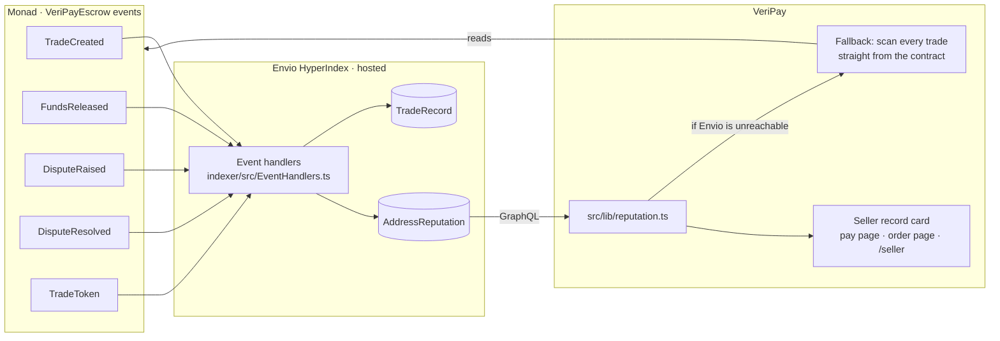

A seller's record is **not a number in VeriPay's database**. It is a deterministic function of `VeriPayEscrow`'s event log (equivalently, of the contract's trade state), computed by two independent implementations that are kept rule-for-rule identical.

<Accordion title="In plain words" icon="lightbulb">
  VeriPay doesn't "keep" a score for each seller. Instead, it counts the seller's real orders from the public blockchain record every time. Two separate counting methods are used, and they always agree.
</Accordion>

## Architecture



## Counting rules

Identical in the indexer and the fallback (checked for every address that has traded):

| Figure | Rule | Indexer trigger | Fallback derivation |
|---|---|---|---|
| `totalTrades` | +1 for buyer **and** seller on every order | `TradeCreated` | every trade where address is buyer or seller |
| `completedTrades` (**Paid out**) | +1 for the seller when they were paid — release, auto-release, or a ruling with `toSeller > 0` | `FundsReleased(to == seller)` or `DisputeResolved(toSeller > 0)` | `seller == address && released` |
| `refundedTrades` | +1 for the buyer when repaid — refund claim or a ruling with `toBuyer > 0` | `FundsReleased(to == buyer)` or `DisputeResolved(toBuyer > 0)` | `buyer == address && refunded` |
| `disputedTrades` | +1 for **both** parties when either raised a dispute | `DisputeRaised` | `disputed` |

<Accordion title="Why the two methods agree">
  The contract sets `released = true` exactly when it emits a `FundsReleased` to the seller or a `DisputeResolved` with `toSeller > 0`; it sets `refunded = true` exactly when it emits `FundsReleased` to the buyer or `DisputeResolved` with `toBuyer > 0`; and `disputed` is set exactly when `DisputeRaised` is emitted. So state flags and event history are two views of the same facts.

  Note: `autoRelease` emits both `AutoReleased` and `FundsReleased`; the indexer only subscribes to `FundsReleased`, so auto-releases are counted exactly once.

  **In plain words:** the "notes" the contract writes and the "current state" it stores always match, so counting either way gives the same answer.
</Accordion>

## Envio indexer

| | |
|---|---|
| Project | `indexer/` — `name: veripay-reputation` |
| Chain | Monad testnet `10143`, via HyperSync (`monad-testnet.hypersync.xyz`) |
| Contract | `0x00bdf9fbc9f59cc6814bbc7a91b19bbad1517e6d` |
| Start block | `63987883` (the escrow's deployment block) |
| Events | `TradeCreated`, `TradeToken`, `FundsReleased`, `DisputeRaised`, `DisputeResolved` |
| Entities | `TradeRecord`, `AddressReputation` |
| Hosting | Envio hosted service, development tier |
| Endpoint | `https://indexer.dev.hyperindex.xyz/09eb2b1/v1/graphql` |

### Schema

```graphql indexer/schema.graphql
type TradeRecord {
  id: ID!            # on-chain trade id, as a string
  buyer: String!
  seller: String!
  amount: BigInt!
  token: String!     # 0x000…000 = native MON
  status: String!    # open | released | refunded | disputed | resolved
  createdAt: BigInt!
}

type AddressReputation {
  id: ID!            # lowercase address
  totalTrades: Int!
  completedTrades: Int!
  disputedTrades: Int!
  refundedTrades: Int!
  lastActivityAt: BigInt!
}
```

`AddressReputation` is only ever modified as a consequence of a `TradeRecord` changing, so it can always be recomputed from `TradeRecord` alone. All address ids are lowercased.

## Chain fallback

`fromChain(address)` in `src/lib/reputation.ts`:

1. Reads `nextTradeId` and scans `max(0, next − 1000)` … `next − 1` (`SCAN_LIMIT = 1000`).
2. Reads trades with `readTrade()` in batches of 20 (works across v1/v2 contract versions).
3. Caches the full trade list in memory for **30 s**, keyed by contract address.
4. Applies the counting rules and builds `TradeSummary[]` (newest first) for `?trades=1`.

## Resolution logic

```ts
export async function getReputation(address, withTrades = false) {
  if (!withTrades) {
    const envio = await fromEnvio(address);         // null if unset, HTTP error, or GraphQL errors
    if (envio) return { source: "envio", reputation: envio };
  }
  const { reputation, trades } = await fromChain(address);
  return { source: "chain", reputation, trades: withTrades ? trades : undefined };
}
```

- Envio responses use `next: { revalidate: 30 }` (Next.js fetch cache).
- An address with no `AddressReputation` row returns zeros (`source: "envio"`).
- `?trades=1` always reads the chain, because the order list needs per-trade detail and asset formatting.

<Accordion title="In plain words">
  VeriPay first asks the fast index. If it's not set up or doesn't answer, VeriPay counts directly from the blockchain instead. If you ask for the full order list, it always reads the blockchain directly.
</Accordion>

## Where it's displayed

| Surface | Component | Data |
|---|---|---|
| Pay page header | Seller card | `GET /api/reputation/:address` |
| Order page, seller card | `ReputationBadge` | same |
| `/create` seller field | `SellerReputationCard` | same, as soon as the address is valid |
| `/seller` (lookup by handle) and `/seller/:address` | page | `?trades=1` for full history |
| `/orders`, `/sell` | `OrdersList` | `?trades=1` |

## Guarantees and limits

| Guarantee | Limit |
|---|---|
| Can't be edited by VeriPay or the seller | Can be inflated by wash trading via a second account (costs the fee per order) |
| Complete — every order emits events | Fallback scans the latest 1,000 orders only |
| Independently re-derivable by anyone | Envio dev tier may lag or be redeployed (endpoint path may change) |
| Disputes count against both parties | Doesn't distinguish who was at fault |

<Tip>
  After any Envio redeploy, check `GET /api/reputation/<addr>` returns `"source":"envio"`. If it returns `"chain"`, the endpoint changed — update `ENVIO_GRAPHQL_URL`.
</Tip>
