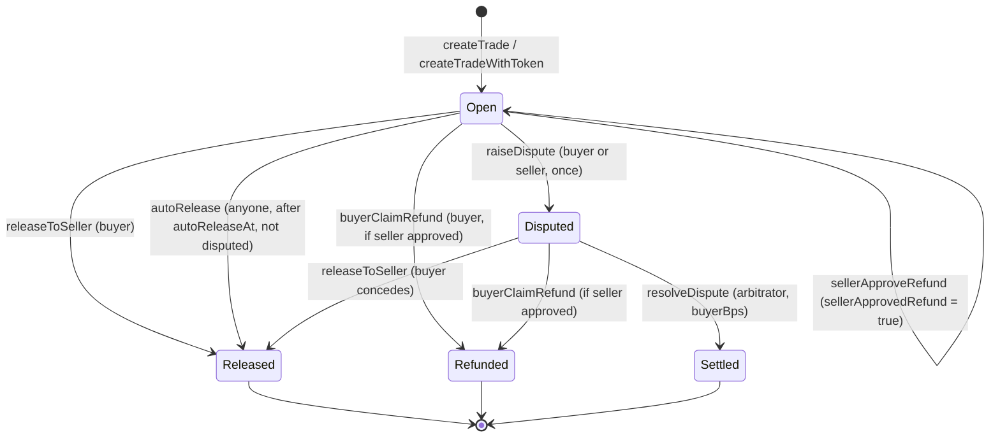

`VeriPayEscrow` holds a buyer's payment until goods or services are delivered. It is a single, dependency-free Solidity file (`contracts/VeriPayEscrow.sol`) with an inlined minimal `IERC20` interface so it deploys from Remix with no import resolution.

<Accordion title="In plain words" icon="lightbulb">
  This is the safe locker. It's one short program that anyone can read. It holds the money for every order and follows a fixed set of rules about who can release it and when.
</Accordion>

## What changed from the first version

The original contract could only end a trade if both parties agreed. If they disagreed, the money sat in the contract **forever**. It also took no fee. This version adds what an escrow actually needs:

| | Original (v1) | VeriPayEscrow (v2) |
|---|---|---|
| Deadlock between buyer and seller | Funds stuck forever | Either party raises a dispute; arbitrator splits any way |
| Buyer stops responding | Seller waits forever | After 7 days anyone can trigger release to the seller |
| Platform revenue | None | 1% default, **only** on successful release |
| Refunds | Full | Full, and **never** charged a fee |
| Fee changes | n/a | Capped at 5% in code; rate locked per trade |
| Owner access to escrowed money | n/a | None — `withdrawFees` only moves earned fees |
| Escrow asset | Native MON only | MON, or any ERC-20 (vNGN, AUSD) via `createTradeWithToken` |

## Lifecycle

"Settled" means `released` and/or `refunded` is true depending on the split. Every terminal state is **final**: `_requireOpen` rejects any further settlement.

## Permissions

| Function | Caller | Preconditions |
|---|---|---|
| `createTrade` | anyone (becomes buyer) | `msg.value > 0`, seller ≠ 0, seller ≠ caller |
| `createTradeWithToken` | anyone (becomes buyer) | token ≠ 0, amount > 0, seller ≠ 0, seller ≠ caller, allowance |
| `releaseToSeller` | buyer | open |
| `autoRelease` | **anyone** | open, not disputed, `now ≥ autoReleaseAt` |
| `sellerApproveRefund` | seller | open |
| `buyerClaimRefund` | buyer | open, `sellerApprovedRefund` |
| `raiseDispute` | buyer or seller | open, not already disputed |
| `resolveDispute` | arbitrator | disputed, open, `buyerBps ≤ 10000` |
| `withdrawFees` | owner | `accruedFees[token] > 0` |
| `setFeeBps` | owner | `≤ 500` |
| `setArbitrator`, `setFeeRecipient` | owner | non-zero |
| `setAutoReleaseDelay` | owner | 1–90 days |
| `transferOwnership` | owner | non-zero |

## Design decisions

<AccordionGroup>
  <Accordion title="Push payments (not pull)">
    Settlement transfers funds to recipients in the same transaction. Simple and gas-efficient for EOAs. **Trade-off:** if a recipient is a contract that rejects transfers, settlement reverts. A claim-based (pull) fallback is planned before mainnet.
  </Accordion>
  <Accordion title="Fee held in the contract, not forwarded">
    Fees are added to `accruedFees[token]` and withdrawn separately. Users' transactions never send funds to VeriPay, and a misbehaving fee recipient can't block settlements.
  </Accordion>
  <Accordion title="Per-asset fee buckets">
    A MON fee and an AUSD fee are not interchangeable. `accruedFees`, `escrowedBalance` and `withdrawFees` are keyed by token address (`address(0)` = MON).
  </Accordion>
  <Accordion title="Field order preserved from v1">
    Struct fields 0–5 keep v1's order, and `TradeCreated`, `FundsReleased`, `RefundAuthorized` keep v1's signatures, so existing readers and indexers keep working.
  </Accordion>
  <Accordion title="TradeToken as a separate event">
    ERC-20 trades emit `TradeToken(id, token)` alongside `TradeCreated` instead of changing `TradeCreated`'s signature — backward compatible for indexers.
  </Accordion>
  <Accordion title="Release allowed during a dispute">
    A buyer conceding should never be blocked. `releaseToSeller` doesn't check `disputed`.
  </Accordion>
  <Accordion title="Permissionless auto-release">
    Anyone can call `autoRelease` once due, so no single keeper is required for liveness. Chainlink CRE is a convenience, not a dependency.
  </Accordion>
  <Accordion title="No constructor arguments">
    Deploys with the sender as owner, arbitrator and fee recipient, 1% fee, 7-day window — all changeable afterwards. Deployment from Remix needs nothing typed.
  </Accordion>
</AccordionGroup>

## Reference

<CardGroup cols={2}>
  <Card title="Storage and types" icon="table" href="/contracts/escrow/storage-and-types" />
  <Card title="Functions" icon="function-square" href="/contracts/escrow/functions" />
  <Card title="Events" icon="radio" href="/contracts/escrow/events" />
  <Card title="Errors (revert reasons)" icon="octagon-x" href="/contracts/escrow/errors" />
  <Card title="Fee math" icon="calculator" href="/contracts/escrow/fee-math" />
  <Card title="Admin operations" icon="settings" href="/contracts/escrow/admin" />
</CardGroup>
