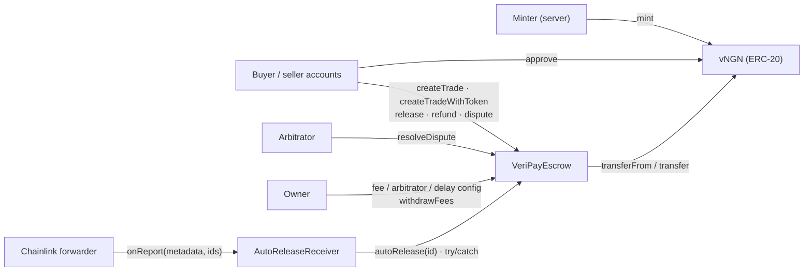

VeriPay's on-chain footprint is deliberately small: **one escrow contract** that holds all money and enforces all rules, **one receiver** that lets Chainlink call a permissionless function on a schedule, and **one test token** that stands in for a naira stablecoin on testnet.

<Accordion title="In plain words" icon="lightbulb">
  Three small programs live on the blockchain: the safe locker that holds everyone's money, a helper that lets Chainlink's robot press the "pay the seller" button, and pretend naira for testing.
</Accordion>

## Contracts

<CardGroup cols={3}>
  <Card title="VeriPayEscrow" icon="vault" href="/contracts/escrow/overview">
    Holds every order's money (MON or any ERC-20). Releases, refunds, disputes, auto-release, success-only fees with a hard 5% cap.
  </Card>
  <Card title="AutoReleaseReceiver" icon="timer" href="/contracts/auto-release-receiver">
    Chainlink CRE consumer. Holds no funds, has no special permission; calls `autoRelease` for each due id in a signed report.
  </Card>
  <Card title="vNGN" icon="coins" href="/contracts/vngn">
    VeriPay Test Naira. 6-decimal, owner-mintable ERC-20. A testnet stand-in — not money.
  </Card>
</CardGroup>

## Guarantees enforced by code

| # | Guarantee | Enforced by |
|---|---|---|
| G1 | The owner cannot move escrowed funds | No such function exists; `withdrawFees` only touches `accruedFees` |
| G2 | The fee can never exceed 5% | `MAX_FEE_BPS = 500` is a `constant`; `setFeeBps` requires `≤ MAX_FEE_BPS` |
| G3 | Fee changes never affect open orders | `Trade.feeBps` snapshotted at creation |
| G4 | Refunds are never charged a fee | Fee computed only on `toSeller` |
| G5 | Only the buyer can release | `require(msg.sender == t.buyer)` |
| G6 | A refund needs the seller's consent | `require(t.sellerApprovedRefund)` in `buyerClaimRefund` |
| G7 | A disputed order can't auto-release | `require(!t.disputed)` in `autoRelease` |
| G8 | Each order settles at most once | `_requireOpen`: `!released && !refunded`; flags set before transfers |
| G9 | No reentrancy during payouts | `nonReentrant` on every function that moves value |
| G10 | Tokens returning `false` are handled | Every ERC-20 call wrapped in `require(...)` |
| G11 | MON can only enter via `createTrade` | `receive()` reverts |
| G12 | Buyer ≠ seller | `require(_seller != msg.sender)` |

Full analysis: [Contract invariants](/security/invariants).

## Source

| Contract | Path | Lines | License |
|---|---|---|---|
| VeriPayEscrow | `contracts/VeriPayEscrow.sol` | 418 | MIT |
| AutoReleaseReceiver | `contracts/cre/AutoReleaseReceiver.sol` | 64 | MIT |
| ReceiverTemplate, IReceiver, IERC165 | `contracts/cre/` | — | MIT (Chainlink, verbatim) |
| VeriPayTestNaira (vNGN) | `contracts/test/VeriPayTestNaira.sol` | 73 | MIT |

Toolchain: Solidity `^0.8.24`, deployed with **Remix** (no Hardhat/Foundry), tested with `solc` + Ganache (`contracts/test/`). Compiled escrow size ~8.1 KB (well under 24 KB).
