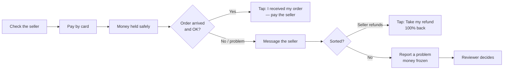

## Your protection in three sentences

1. When you pay, the money goes into a **locked account controlled by code**, not to the seller and not to VeriPay.
2. The seller is paid **only** when you confirm the order arrived, when a reviewer decides after a problem report, or automatically **7 days** after you paid if you do nothing.
3. If anything is wrong, **report a problem before the 7 days are up**, and the money freezes until it's reviewed.

<Warning>
  **The one deadline that matters:** you have **7 days** from payment to either confirm delivery or report a problem. After that, the seller can be paid automatically. Each order page shows a countdown — e.g. *"3d 4h left for the buyer to confirm delivery."*
</Warning>

## Your journey

## Guides

<CardGroup cols={2}>
  <Card title="Check a seller" icon="search" href="/guides/buyers/check-a-seller">
    Look up anyone's real track record before you pay.
  </Card>
  <Card title="Pay through a link" icon="credit-card" href="/guides/buyers/pay-through-a-link">
    Pay in naira by card, step by step.
  </Card>
  <Card title="Confirm delivery" icon="package-check" href="/guides/buyers/confirm-delivery">
    Release the money when you're happy.
  </Card>
  <Card title="Report a problem" icon="triangle-alert" href="/guides/buyers/report-a-problem">
    Freeze the money and get a review.
  </Card>
  <Card title="Refunds" icon="rotate-ccw" href="/guides/buyers/refunds">
    Get 100% of your money back.
  </Card>
  <Card title="Receipts and proof" icon="receipt" href="/guides/buyers/receipts-and-proof">
    Understand your receipt and verify it yourself.
  </Card>
</CardGroup>

## Golden rules

<AccordionGroup>
  <Accordion title="Only confirm when you actually have the item" icon="check">
    Confirming delivery pays the seller **immediately and irreversibly**. Never confirm because a seller asks you to "confirm so I can ship".
  </Accordion>
  <Accordion title="Always pay through the VeriPay link, never by direct transfer" icon="link">
    A real VeriPay link always shows the seller's record. If a seller asks you to transfer directly "to save fees", you lose all protection.
  </Accordion>
  <Accordion title="Check the link address" icon="globe">
    Genuine links are on `veripay.store/pay/...`. Be suspicious of look-alike domains.
  </Accordion>
  <Accordion title="Describe the item clearly when paying" icon="file-text">
    The "What are you buying?" field is stored on-chain as the order's description and is what a reviewer reads if there's a dispute. Be specific: *"iPhone 13, 128GB, blue, UK used"* beats *"phone"*.
  </Accordion>
  <Accordion title="Keep the conversation in the order chat" icon="message-circle">
    If there's a dispute, messages in the order's chat are visible to the reviewer.
  </Accordion>
</AccordionGroup>
