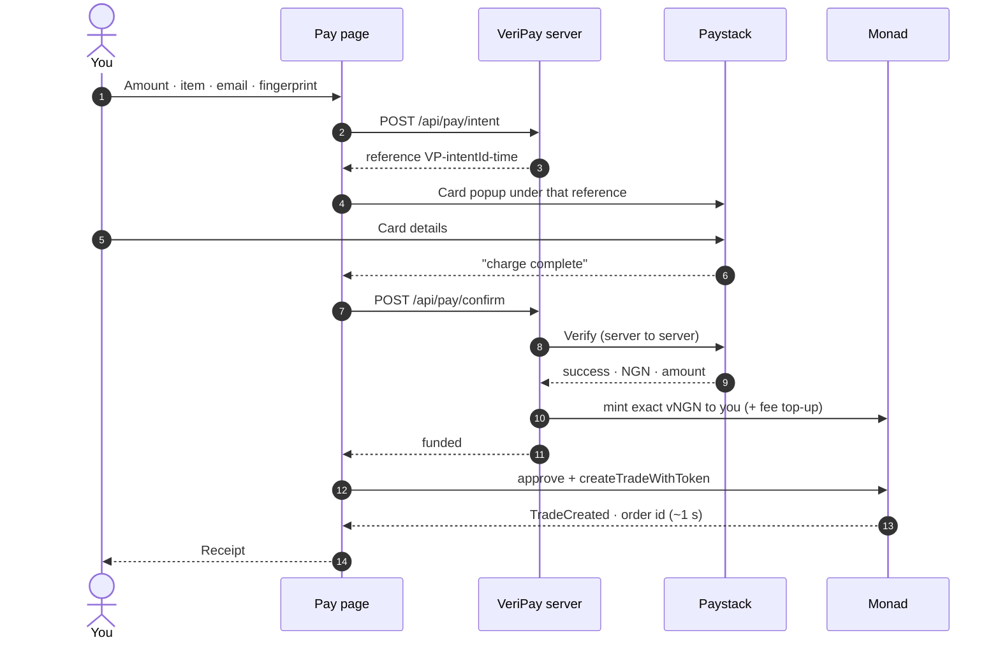

import TestnetNote from '/snippets/testnet-note.mdx';

<TestnetNote />

## Before you start

- The seller's link, e.g. `veripay.store/pay/adaeze-thrift`.
- A card (on testnet: `4084 0840 8408 4081`, any future expiry, CVV `408`).
- A phone or computer with Face ID / fingerprint, or another sign-in method.

## Step by step

<Steps>
  <Step title="Open the link and check the seller">
    You'll see the shop name, `@handle` and their record. If the page says **"This payment link doesn't exist."**, double-check the spelling with the seller — a real VeriPay link always shows their record.
  </Step>
  <Step title="Enter the order">
    - **Amount (₦)** — between ₦100 and ₦5,000,000.
    - **What are you buying?** — at least 3 characters. Be specific; this becomes the order description stored on-chain and is what a reviewer reads if there's a problem.
    - **Email for your receipt**.
  </Step>
  <Step title="Sign in">
    Tap **Use Face ID / fingerprint** (or **Other ways to sign in**). See [Sign in](/guides/sign-in).
  </Step>
  <Step title="Pay">
    Tap **Pay ₦… safely**. The button walks through *Opening card payment… → Confirming payment… → Securing your money…*. Complete the Paystack card popup.
  </Step>
  <Step title="Get your receipt">
    You'll see **Payment secured** with: the amount, who you paid, what it's for, the **order number** (e.g. `#0009`), the **reference** (`VP-…`), status **Held until you confirm delivery**, and a line such as *"Secured in 1.1s · network fee ₦0.72, paid for you"*.
  </Step>
</Steps>

## What happens behind each tap

<Accordion title="In plain words" icon="lightbulb">
  1. VeriPay writes down what you're about to pay for and gives the payment a unique reference.
  2. You pay with your card.
  3. VeriPay asks the card company directly "did that really work, and for how much?"
  4. Once confirmed, you're given the same amount in digital naira, plus a little fuel for the network.
  5. Your phone locks that money away for the seller — in about a second.
</Accordion>

## If something goes wrong

<AccordionGroup>
  <Accordion title="The page closed / lost signal after I paid">
    Open the same seller link again, sign in the same way, and enter the same amount. The page sees you already hold that payment, **skips the card**, and finishes locking it. You won't be charged twice.
  </Accordion>
  <Accordion title="&quot;Your payment went through, but we couldn't finish setting up the escrow. Tap retry — you won't be charged again.&quot;">
    The card charge succeeded but issuing your digital naira failed (for example a network hiccup). Tap **Retry securing payment**. The server releases its delivery slot on failure, so a retry can complete it.
  </Accordion>
  <Accordion title="&quot;We're still getting your payment ready. Wait a few seconds and tap retry&quot;">
    The network-fee top-up hasn't landed yet. Wait a few seconds and tap retry.
  </Accordion>
  <Accordion title="&quot;You can't pay your own link.&quot;">
    You're signed in with the seller's own account. Sign in with a different account.
  </Accordion>
  <Accordion title="&quot;Card checkout isn't switched on for this site yet.&quot;">
    The deployment has no Paystack public key configured. This is an operator issue; contact the seller or VeriPay.
  </Accordion>
  <Accordion title="&quot;Card payment was ₦X, but this order needs ₦Y.&quot;">
    Paystack reports a smaller charge than the order. The server never accepts a short payment (beyond ₦1 rounding tolerance).
  </Accordion>
</AccordionGroup>

## After paying

- The seller is notified straight away.
- Find the order any time under **My orders**.
- When it arrives, [confirm delivery](/guides/buyers/confirm-delivery). If it doesn't, [report a problem](/guides/buyers/report-a-problem) within 7 days.
