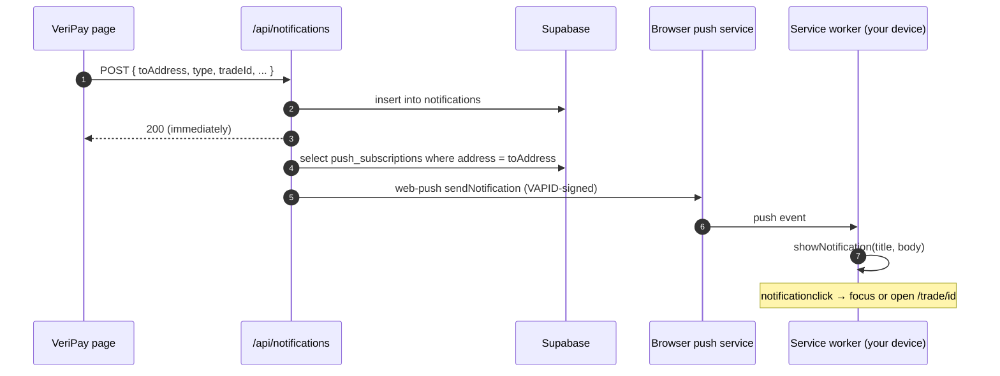

VeriPay has two notification channels:

| Channel | Where | Works when VeriPay is closed? | How |
|---|---|---|---|
| **In-app bell** | Top bar | No | `notifications` table, polled every ~20 s while visible |
| **Device alerts** | Your phone / computer's notification centre | **Yes** | Web Push (VAPID) via the service worker |

<Accordion title="In plain words" icon="lightbulb">
  The bell shows alerts while you have VeriPay open. "Device alerts" are real phone notifications that reach you even when VeriPay is closed — you have to switch them on once.
</Accordion>

## Turn on device alerts

<Steps>
  <Step title="Sign in">
    Device alerts are tied to your account, so sign in first.
  </Step>
  <Step title="Open the bell">
    Tap the bell icon in the top bar.
  </Step>
  <Step title="Enable Device Alerts">
    Tap **Enable Device Alerts** and allow notifications when your browser asks. The button changes to **Device Alerts On**. If it says **Blocked in Browser Settings**, you previously denied permission — allow notifications for `veripay.store` in your browser settings and try again.
  </Step>
</Steps>

<Note>
  On **iPhone**, web push only works for apps [installed to the home screen](/guides/install-app) (iOS 16.4+). Install first, then enable alerts from inside the installed app.
</Note>

## What you'll be notified about

| Event | Who | Title | Opens |
|---|---|---|---|
| A buyer paid through your link | Seller | *Payment secured for you* — "A buyer just locked ₦… for you. Deliver, and it's yours." | `/trade/<id>` |
| A buyer opened a direct MON escrow to you | Seller | *Payment secured for you* | `/trade/<id>` |
| New message on an order | The other party | *New Message · Trade #00[id]* | `/trade/<id>` |

## How it works

- Push sending is **best-effort**: a push failure never fails the request.
- Subscriptions that the push service reports as gone (`404`/`410`) are deleted automatically.
- If your browser rotates its subscription, the service worker's `pushsubscriptionchange` handler calls `/api/push/resubscribe` to carry your address forward.

## Turn alerts off

Tap the bell → tap **Device Alerts On** to toggle it off, or revoke notification permission for `veripay.store` in your browser or phone settings. VeriPay deletes the subscription via `POST /api/push/unsubscribe`.
