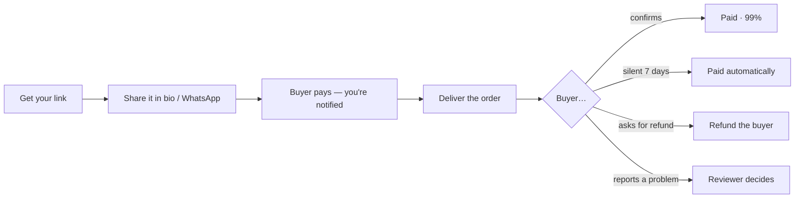

## What VeriPay gives you

<CardGroup cols={2}>
  <Card title="Customers who pay without hesitating" icon="badge-check">
    Your link shows your real record — *"14 paid out · 0 disputes"* — so buyers stop asking for proof.
  </Card>
  <Card title="Proof the money exists before you ship" icon="lock">
    You see each order as **Paid — deliver this order** only after the money is locked. It can't be reversed by a chargeback-style trick.
  </Card>
  <Card title="Guaranteed payout" icon="timer">
    Paid when the buyer confirms — or automatically after 7 days if they go silent and don't report a problem.
  </Card>
  <Card title="No crypto, no fees to manage" icon="fuel">
    Fingerprint sign-in, naira everywhere, network fees covered.
  </Card>
</CardGroup>

## Your journey

## Guides

<CardGroup cols={2}>
  <Card title="Get your payment link" icon="link" href="/guides/sellers/get-your-link">
    Claim your link in under a minute.
  </Card>
  <Card title="Share your link" icon="share-2" href="/guides/sellers/share-your-link">
    Where to put it and what to say.
  </Card>
  <Card title="Deliver and get paid" icon="banknote" href="/guides/sellers/deliver-and-get-paid">
    Every way an order pays out.
  </Card>
  <Card title="Refund a buyer" icon="rotate-ccw" href="/guides/sellers/refund-a-buyer">
    When and how to give money back.
  </Card>
  <Card title="Your record" icon="scroll-text" href="/guides/sellers/your-record">
    How it's counted and how to grow it.
  </Card>
</CardGroup>

## What you earn

You receive **99%** of each order (the fee is 1%, charged only when you're paid). On a **₦25,000** order you receive **₦24,750**. See [Fees](/product/fees-and-pricing).

<Warning>
  **Testnet:** your balance is test naira (vNGN) and cannot yet be withdrawn to a bank account. Bank payouts need a licensed naira stablecoin or payout partner — this is the top business item on the [roadmap](/resources/roadmap).
</Warning>

## Do's and don'ts

| ✅ Do | ❌ Don't |
|---|---|
| Ship only after the order shows **Paid — deliver this order** | Ship because a buyer sent a "payment screenshot" |
| Keep all conversation in the order chat | Ask buyers to "confirm first so I can ship" |
| Refund promptly if you can't deliver | Ignore refund requests — the buyer can report a problem |
| Describe items clearly so expectations match | Ask buyers to transfer outside VeriPay |
