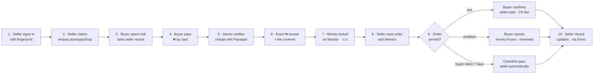
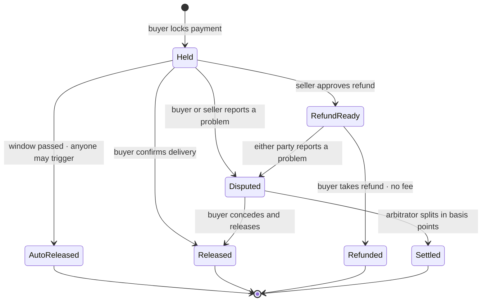

VeriPay composes five subsystems into one consumer flow: **passkey accounts** (identity), a **card-to-token pipeline** (funding), a **non-custodial escrow contract** (custody and rules), an **event-sourced reputation index** (trust signal) and a **scheduled automation workflow** (liveness). This page follows a single order through all five.

<Accordion title="In plain words" icon="lightbulb">
  VeriPay is five pieces working together:
  1. **Sign-in** with your fingerprint instead of a password.
  2. **Paying** with your normal card in naira.
  3. **A safe locker** that holds the money until delivery.
  4. **A public track record** for every seller.
  5. **A robot** that pays the seller if the buyer goes silent.

  Below, we follow one order through all five.
</Accordion>

## The journey of one order

## Step by step

<Steps>
  <Step title="Identity — the seller signs in" icon="fingerprint">
    The browser performs a WebAuthn registration or assertion with the **PRF (pseudo-random function) extension** via Category Labs' `@category-labs/mera`. The PRF output (32 bytes) is used as BIP-39 entropy → seed → BIP-32 derivation at `m/44'/60'/0'/0/0` → secp256k1 private key → a viem `LocalAccount`, wrapped as a thirdweb `Wallet` with `createWalletAdapter`.
    <Accordion title="In plain words">
      Your fingerprint unlocks a secret that only your device can produce. VeriPay's page turns that secret into your account, every time, on your device. Nothing secret is sent to VeriPay, and there's nothing for you to write down.
    </Accordion>
    Details: [Passkey accounts](/architecture/passkey-accounts).
  </Step>

  <Step title="Seller link — a signed handle claim" icon="link">
    The seller submits `{handle, name, address, signature}` to `POST /api/sellers`. The server normalises the handle, enforces the regex and reserved-word list, verifies the EIP-191 personal-sign signature over `claimMessage(handle, address)`, enforces one link per address, and inserts into `sellers` (where `handle` is the primary key and `address` is `UNIQUE`).
    <Accordion title="In plain words">
      The seller picks a link name and proves the link is theirs by approving it with their account. VeriPay checks the proof, makes sure nobody else has that name, and saves it. Each account gets exactly one link.
    </Accordion>
    Details: [Get your payment link](/guides/sellers/get-your-link) · [`POST /api/sellers`](/api/sellers/claim).
  </Step>

  <Step title="Trust signal — the buyer sees the seller's record" icon="badge-check">
    The pay page calls `GET /api/reputation/:address`. The server queries Envio HyperIndex (`AddressReputation` entity) and, if Envio is unconfigured or unreachable, recomputes the same figures by scanning up to the latest 1,000 trades directly from the contract with identical counting rules (30-second cache).
    <Accordion title="In plain words">
      The page looks up the seller's history of real orders and shows how many went well and how many had problems. If the fast lookup service is down, it reads the history straight from the blockchain instead — same numbers, just slower.
    </Accordion>
    Details: [Reputation](/architecture/reputation).
  </Step>

  <Step title="Funding — card payment to on-chain naira" icon="credit-card">
    `POST /api/pay/intent` → Paystack inline charge under a server-minted reference → `POST /api/pay/confirm` → server-to-server verification → optimistic-concurrency claim of the intent → single delivery slot → `vNGN.mint(buyer, amount)` → conditional gas top-up.
    <Accordion title="In plain words">
      You pay with your card. VeriPay asks the card company directly whether it worked and for how much. Only then does it give you exactly that much digital naira, plus a tiny amount of network fuel so you can lock it away. It's built so that a double-tap or a retry can never pay out twice.
    </Accordion>
    Details: [Card to escrow pipeline](/architecture/card-to-escrow).
  </Step>

  <Step title="Custody — the escrow lock" icon="lock">
    The buyer's device calls `vNGN.approve(escrow, amount)` then `VeriPayEscrow.createTradeWithToken(seller, item, vNGN, amount)`. The contract pulls tokens via `transferFrom`, writes a `Trade` struct with `createdAt`, `autoReleaseAt = now + autoReleaseDelay` and a snapshotted `feeBps`, and emits `TradeCreated` + `TradeToken`.
    <Accordion title="In plain words">
      Your phone moves the money into the safe locker and writes down the rules for this order: who's buying, who's selling, how much, and the date after which the seller gets paid automatically. Everyone can see this record; nobody can change it.
    </Accordion>
    Details: [Escrow functions](/contracts/escrow/functions).
  </Step>

  <Step title="Notification — the seller is told" icon="bell">
    The page posts to `/api/notifications`, which writes a row to `notifications` (shown in the in-app bell, polled every ~20 s) and fires a best-effort **Web Push** (VAPID) to every subscribed device of the seller.
    <Accordion title="In plain words">
      The seller gets an alert in the app and, if they switched on device alerts, a notification on their phone — even if VeriPay isn't open.
    </Accordion>
  </Step>

  <Step title="Settlement — one of four endings" icon="git-fork">
    | Ending | Call | Who | Money |
    |---|---|---|---|
    | Delivered | `releaseToSeller(id)` | Buyer | 99% seller, 1% fee bucket |
    | Refund | `sellerApproveRefund(id)` → `buyerClaimRefund(id)` | Seller, then buyer | 100% buyer, no fee |
    | Dispute | `raiseDispute(id)` → `resolveDispute(id, buyerBps)` | Either party, then arbitrator | Split by basis points; fee only on the seller's share |
    | Buyer silent | `autoRelease(id)` after `autoReleaseAt` | Anyone (Chainlink CRE in practice) | 99% seller, 1% fee bucket |
    <Accordion title="In plain words">
      Every order ends in one of four ways: the buyer says "got it" and the seller is paid; the seller agrees to refund and the buyer gets everything back; a reviewer decides a fair split after a problem is reported; or the buyer goes silent for 7 days and the seller is paid automatically.
    </Accordion>
    Details: [Order journey](/architecture/order-journey) · [Disputes](/architecture/disputes-and-arbitration) · [Auto-release](/architecture/auto-release).
  </Step>

  <Step title="Record — reputation updates itself" icon="refresh-cw">
    Envio's handlers consume `FundsReleased`, `DisputeRaised` and `DisputeResolved` and increment `completedTrades`, `refundedTrades` and `disputedTrades` on the relevant `AddressReputation` entities. No VeriPay server writes to reputation.
    <Accordion title="In plain words">
      As soon as the order finishes, the seller's public record updates by itself, based only on what actually happened.
    </Accordion>
  </Step>
</Steps>

## Who can do what, at a glance

<Note>
  `releaseToSeller` is deliberately allowed **during** a dispute: it represents the buyer conceding, and the contract never blocks a buyer from paying a seller. `autoRelease`, by contrast, is blocked while `disputed == true`.
</Note>

## What the buyer and seller actually see

VeriPay deliberately hides every crypto concept on consumer pages. The table maps what happens on-chain to what a person reads on screen.

| On-chain state | Buyer sees | Seller sees |
|---|---|---|
| `Trade` created, open | **Held safely — confirm when it arrives** | **Paid — deliver this order** |
| `sellerApprovedRefund = true` | **Refund ready** · *Take my refund* | **Refund ready** |
| `disputed = true` | **Under review** · money **Frozen** | **Under review** |
| `released = true` | **Completed** | **Paid out to you** |
| `refunded = true` | **Refunded to you** | **Refunded to buyer** |
| `released && refunded` (split ruling) | **Settled by review** | **Settled by review** |

<Accordion title="Why hide the crypto?" icon="eye-off">
  VeriPay's users are Instagram and WhatsApp shoppers, not crypto traders. The product rule is that **addresses, "MON", "escrow" and "wallet" never appear on consumer pages** (`/pay`, `/sell`, `/orders`, `/trade`). The chain is visible in exactly one place — the receipt line "Secured in 1.1s · network fee ₦0.72, paid for you" — and on the optional proof page for anyone who wants to check.
</Accordion>
