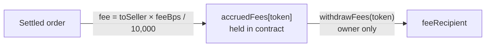

## The escrow fee

| | |
|---|---|
| **Rate** | `feeBps = 100` → **1%** (default at deployment) |
| **Charged to** | The **seller**, deducted from their payout |
| **Charged when** | Only when money is paid **to the seller** — release, auto-release, or the seller's share of a dispute ruling |
| **Never charged on** | Refunds (buyer always gets 100% back) · the buyer's share of a dispute ruling |
| **Hard ceiling** | `MAX_FEE_BPS = 500` → **5%**, a Solidity `constant` that cannot be changed |
| **Rate changes** | `setFeeBps` affects **new** orders only; each `Trade` stores its own `feeBps` snapshot |

<Accordion title="In plain words" icon="lightbulb">
  VeriPay takes 1% from the seller, and only when the seller gets paid. If the order is refunded, nobody pays anything. VeriPay can never charge more than 5%, and if it ever raises the fee, it won't apply to orders already in progress.
</Accordion>

### Worked examples

<Tabs>
  <Tab title="Normal release">
    Buyer locks **₦5,000**. Buyer confirms delivery.

    | | Amount |
    |---|---|
    | Seller receives | ₦4,950 |
    | Fee (to `accruedFees[vNGN]`) | ₦50 |
    | Buyer pays extra | ₦0 |
  </Tab>
  <Tab title="Refund">
    Buyer locks **₦5,000**. Seller approves refund; buyer claims it.

    | | Amount |
    |---|---|
    | Buyer receives | ₦5,000 |
    | Fee | ₦0 |
  </Tab>
  <Tab title="50/50 ruling">
    Buyer locks **₦5,000**. Dispute raised; arbitrator calls `resolveDispute(id, 5000)`.

    | | Amount |
    |---|---|
    | Buyer receives | ₦2,500 |
    | Seller's gross share | ₦2,500 |
    | Fee (1% of seller's share) | ₦25 |
    | Seller receives | ₦2,475 |
  </Tab>
  <Tab title="Auto-release">
    Buyer locks **₦5,000** and goes silent for 7 days. CRE triggers `autoRelease`.

    | | Amount |
    |---|---|
    | Seller receives | ₦4,950 |
    | Fee | ₦50 |
  </Tab>
</Tabs>

<Accordion title="Rounding">
  Fees use integer division: `fee = toSeller * feeBps / 10_000`, rounding **down**. vNGN and AUSD have 6 decimals, so rounding only matters below one millionth of a naira. Any rounding dust stays with the seller, never the fee bucket. See [Fee math](/contracts/escrow/fee-math).
</Accordion>

## Network (gas) fees

| | |
|---|---|
| **Cost of a lock** | ≈ 0.02 MON (< ₦1) |
| **Who pays** | VeriPay, by topping up the user's account with **0.15 MON** when it falls below **0.08 MON** |
| **Limit** | 3 top-ups per card-funded payment; 3 per registered seller |
| **Who is eligible** | Buyers with a card-funded payment; registered sellers with ≥ 1 order |

<Accordion title="In plain words">
  The blockchain charges a tiny fee for each action. VeriPay quietly puts a little fuel in your account so you never see or pay it. There's a limit so people can't abuse it for free tokens.
</Accordion>

## Card processing

On the **pay-link** flow, the buyer pays exactly the order amount; Paystack's processing fee is absorbed by the merchant account in the current test setup.

On the **exchange** card flow, Paystack's fee is passed through as a separate, visible line item:

```text
cardFee = min( amount × 1.5% + (amount ≥ ₦2,500 ? ₦100 : ₦0), ₦2,000 )
```

## Exchange spread

The naira ⇄ crypto exchange (a separate, pre-hackathon feature) earns a **spread**, default **3.5%** (`EXCHANGE_SPREAD_PERCENT`, clamped 0–25%):

- Buy price per coin = mid-market × (1 + spread)
- Sell price per coin = mid-market × (1 − spread)

The spread is sized to absorb 1–2% coin volatility over a 15-minute locked quote, ~0.2% transfer and gas costs, and ~1% between the quoted street rate and true cost of funds — and still sit under the 5–8% typical of Nigerian on-ramps. See [Exchange engine](/architecture/exchange-engine).

## Where fees go



Fees accumulate **per asset** (`accruedFees[address(0)]` for MON, `accruedFees[vNGN]`, `accruedFees[AUSD]`) and are never sent onward inside a user's transaction. The owner withdraws one asset at a time to `feeRecipient`.
